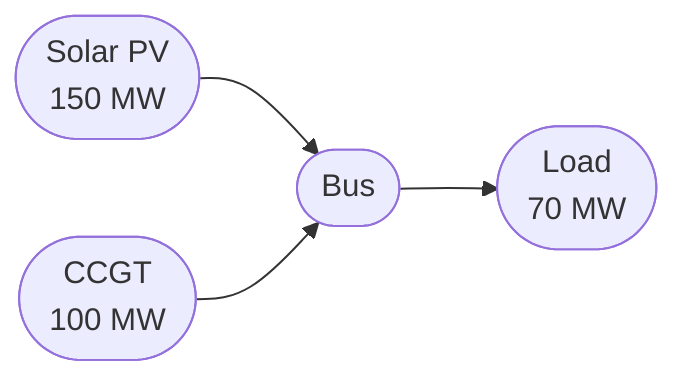

# Write the docs

Principles for writing and improving the Odys documentation. The voice is the same on every page: friendly, light and exact (§13).

## Checklist

- [ ] Find the page's place in the [information architecture](#information-architecture) and the question it answers (§2).
- [ ] Start from the matching template in [templates.md](templates.md): an asset or market page, a formulation page, or an example page.
- [ ] Check which section owns each fact (§10). Link to facts another page owns instead of explaining them again.
- [ ] Write in the voice of §13. On formulation pages, explain every rule by what the optimizer would get away with without it (§11).
- [ ] Equations only in `docs/formulation/`, in the constraint rhythm of §4. User Guide and Examples pages link to the constraint instead.
- [ ] User Guide code runs in order and shows its exact output (§3). Reuse the running example's names.
- [ ] End with a bridge to the next page (§15), and cross-link where concepts appear (§17).
- [ ] Add new pages to the `nav` in `zensical.toml`.
- [ ] Run `just docs-build` (strict build, plus `tools/docs/check_user_guide.py`) before saying the page is done.

## 1. Make the Quickstart unbelievably good

This is the most important page. Someone should be able to install the package, copy 20-30 lines of code, see a useful result, and understand why it works -- within 5 minutes.

The quickstart lives on `index.md` as the "Quick example" section. The "Get started" button links to `user_guide/model/first_model.md`, which expands on the same workflow.

The smallest example that makes someone think "now I get it" is not a toy. It is a realistic dispatch problem with a generator, a load, and a visible result:

```python
from datetime import timedelta

from odys import AssetPortfolio, EnergySystem, Generator, FixedLoad, LoadProfile, Scenario

generator = Generator(name="gen", nominal_power=100.0, variable_cost=50.0)
load = FixedLoad(name="demand")

portfolio = AssetPortfolio([generator, load])

energy_system = EnergySystem(
    portfolio=portfolio,
    scenarios=Scenario(profiles=(LoadProfile(load=load, values=[60, 90, 40, 70]),)),
    timestep=timedelta(hours=1),
    number_of_steps=4,
)

result = energy_system.optimize()
print(result.generators.power)
```

## 2. Tell a story instead of listing features

Follow the user's journey. Each page answers the next question a user naturally has:

1. What is this and how do I install it? (`index.md`)
2. How do I set up my first system? (`user_guide/model/`)
3. What assets can I model? (`user_guide/assets/`)
4. Where can I buy and sell energy? (`user_guide/markets/`)
5. What does the optimizer maximize, and how do I read the results? (`user_guide/optimization/`)
6. What if the future is uncertain? (`user_guide/optimization/stochastic.md`)
7. Can I see a full worked example? (`examples/`)
8. What exactly does odys solve, and why that way? (`formulation/`)

Think in terms of "What is the user wondering now?" not "What feature should I describe?"

The same holds inside each section. Every page ends with the question it leaves open (see §15), and opens before any code or symbol:

- A User Guide page opens by saying what the type models, in the reader's terms: "A `Generator` models a gas turbine, a diesel engine, or a wind or solar farm whose output depends on the weather." The readers know the energy domain, so skip hook questions and explanations of domain basics. Motivate a feature with a planning situation they recognize: "Say you're optimizing tomorrow's dispatch, and the CCGT is running tonight."
- A formulation page opens with the question it answers, in everyday words ("How do I make my own power?").

## 3. Every page should have runnable examples

Every page contains executable code. Not pseudocode. Real code. Not every page has to solve, though: a page that builds only part of a system (vehicles without chargers, say) shows runnable code and leaves the solve to the page that completes it, linking there. The code blocks of a page run in order, from its first block, without names from other pages. A block that shows output is followed by a `text` block with exactly what it prints. `just docs-build` runs `tools/docs/check_user_guide.py`, which executes every User Guide page and fails on an error or an output that differs (column spacing and the sign of zero aside). Avoid ties: when several dispatches are equally optimal, the solver may print another one, so change the data until the optimum is unique, and round what you print.

The User Guide builds on one running example, described on `user_guide/index.md`: reuse its names and numbers (`ccgt`, `wind`, `factory`, `process`, `bess`, `day_ahead`) rather than inventing a new system on each page.

Pattern:

1. Here is the problem.
2. Here is the solution.
3. Here is the output.
4. Here is what changed.

Someone can almost learn by scrolling.

The exception is the Mathematical Formulation section (`formulation/`): it describes the model, so its pages have no code and no running example. `check_user_guide.py` runs only `user_guide/`.

## 4. Anchor every equation in words

Odys is a mathematical library. Equations are a first-class part of the documentation, not something to hide, but they always come with words around them.

Equations live only in the Mathematical Formulation section (`docs/formulation/`), written once, on the page of the model part that owns them. User Guide and Examples pages carry no math at all, not even an inline symbol: they explain the behaviour in words and link to the constraint ("The output can change by at most `ramp_up` per step; see [G-7](../../formulation/generators.md#g-7).").

On formulation pages, every constraint follows the same rhythm (see the formulation page template in [templates.md](templates.md)):

1. A heading that says what happens: `G-7 · Output changes gradually`, not `G-7 · Ramp limits`.
2. One plain sentence on what it enforces.
3. The equation. With a binary, the logical form first, then the big-M form with the value of M.
4. The equation read aloud, in one everyday sentence.
5. Why it looks like this: what the optimizer would get away with without it (§11).
6. Good to know, when there is something: limitations and redundancy.
7. A facts line: `Added: … · Binds: … · Name: <linopy name>`.

Instead of:

> The following constraint can optionally be applied to limit the generator output...

Write:

> **G-4 · Output fits the available capacity.** A generator never produces more than the scenario lets it.
>
> $$p_{g,s,t} \le A_{g,s,t}$$
>
> Read aloud: at every step, output stays below what the wind, the sun or the fuel supply allows.

Keep it short. People skim, and examples and equations beat paragraphs, but the few words around an equation are what make it readable.

## 5. One concept per section

Within a page, each `##` heading covers one idea. Across the site, each page has a clear focus.

A page like `assets/generator.md` covers:

- Basic usage (one concept)
- Ramp limits (one concept)
- Minimum up and down time (one concept)
- Startup and shutdown cost (one concept)
- Results (one concept)
- How it's modelled (one concept: links to the formulation)

Each section is self-contained. A reader can jump to "Ramp constraints" without reading the rest.

## 6. Progressive disclosure

Beginners see:

```python
gen = Generator(name="gen", nominal_power=100.0, variable_cost=50.0)
```

Intermediate users learn:

```python
gen = Generator(
    name="gen",
    nominal_power=100.0,
    variable_cost=50.0,
    ramp_up=50.0,
    min_up_time=timedelta(hours=4),
)
```

Advanced users discover:

```python
gen = Generator(
    name="gen",
    nominal_power=100.0,
    variable_cost=50.0,
    ramp_up=50.0,
    min_up_time=timedelta(hours=4),
    startup_cost=500.0,
    min_power=20.0,
)
```

The docs never overwhelm. Complexity appears only when needed.

## 7. Have an opinion

Don't say "there are many ways." Say "use this." Then later: "if you need something more advanced..."

Opinionated documentation reduces cognitive load. For example:

> Use a single `Scenario` for deterministic problems. When you need to account for uncertainty, pass several scenarios, each with a `probability`.

## 8. Make examples realistic

Bad:

```python
x = Foo()
```

Good:

```python
solar = Generator(name="solar_pv", nominal_power=150.0, variable_cost=0.0)
load = FixedLoad(name="load")
scenario = Scenario(
    profiles=(
        AvailableCapacityProfile(generator=solar, values=[0, 30, 60, 80, 100, 80, 60, 30, 0]),
        LoadProfile(load=load, values=9 * [70]),
    ),
)
```

Someone working in energy optimization immediately recognizes the problem.

## 9. Use diagrams

Mermaid diagrams clarify system structure and data flow. Use them for:

**Asset topology** (as in `basic_dispatch.md`):



**Optimization workflow**:

```
Assets --> AssetPortfolio --> EnergySystem --> optimize() --> Results
```

**Object relationships**:

```
EnergySystem
 ├── AssetPortfolio
 │    ├── Generator
 │    ├── StationaryStorage
 │    ├── ElectricVehicle
 │    ├── Charger
 │    ├── FixedLoad
 │    └── FlexibleLoad
 ├── Scenario | Scenario[] (with probabilities)
 ├── initial_conditions / final_conditions (optional)
 └── EnergyMarket[] (optional)
```

Good diagrams replace pages of text.

## 10. Who owns what

Every fact has one home. The other sections link to it instead of explaining it again. Each section answers one question:

| Section | The question it answers | It holds | It never holds |
| ------- | ----------------------- | -------- | -------------- |
| User Guide (`user_guide/`) | How do I use it? | What a type or field does in practice and when to use it, runnable code on the running example, fields tables, profiles, results | Math, inline symbols included; why the model is written that way; limitations and known issues |
| Mathematical Formulation (`formulation/`) | What exactly is solved, and why that way? | Equations, "Why it looks like this", limitations, issue links, what's checked before solving, symbol → attribute tables | Code, how-to steps, the running example |
| Examples (`examples/`) | How do I solve this problem end to end? | The story of the problem, its diagram, the walkthrough of `examples/*.py`, what the results mean for this case | Explanations of features or concepts, and math: link to the User Guide and the formulation instead |
| API Reference (`developer/api/`) | What is the exact signature? | Signatures, types and defaults, from the docstrings | Tutorials and math: link to the User Guide and the formulation |

The same fact often comes up in several places. This is where it lives, and how the others refer to it:

| Fact | Lives in | Elsewhere |
| ---- | -------- | --------- |
| What a field means, its unit and default | The User Guide's fields table (it matches the docstring) | The formulation's symbol table names the attribute |
| What a feature does in practice | A User Guide feature section, in one or two sentences | Examples link to it |
| The rule itself, why it looks like this, its limitations and known issues | The formulation constraint | The User Guide feature section ends with "See [G-7](../../formulation/generators.md#g-7)". It may say that a limit exists ("ramps apply at start-up too; see G-7"), but doesn't explain it |
| A worked case, with numbers and results | An example | The User Guide links to it in its next steps, where it helps |

Before you write a paragraph, ask which section owns it. If another page already says it, link to that page. If the owner page is missing it, add it there, once.

## 11. Explain the rationale

Don't just explain what. Explain why.

Instead of:

> The storage model uses binary charging mode variables.

Explain:

> A binary variable stops the battery from charging and discharging at the same time. Every round trip loses energy, so when prices go negative, the optimizer would otherwise do both at once on purpose, burning energy to get paid for it.

The easiest way to explain a rule is to say what the optimizer would get away with without it.

That explanation belongs to the constraint's "Why it looks like this" on the formulation page (§10). A User Guide page says what the feature does for you in practice, and links there:

> Without a charging mode, a battery could charge and discharge at the same time. odys rules that out; see [B-1](../../formulation/batteries.md#b-1).

## 12. The user guide is primary; the API reference is secondary

The user guide teaches the workflow with runnable examples. The API reference (`developer/api/`) provides exact signatures for when the user needs details.

Most users should never need to read the API reference to use Odys. The user guide should be self-sufficient.

## 13. Voice: friendly, light, exact

Write like you're pair programming with the reader. This applies to every page: User Guide, Examples and Mathematical Formulation.

Instead of:

> The `EnergySystem` class encapsulates the optimization workflow...

Write:

> Let's set up our first energy system.
>
> Now let's optimize it.
>
> Notice how the solver uses solar first because it's free?

Rules:

- Address the reader as "you". Treat the optimizer as a character: "the optimizer would happily…".
- Short sentences, one idea per paragraph.
- Say each symbol or field in words the first time it appears on a page.
- Use small concrete numbers when they help: "a battery that is 90 % efficient loses 0.1 MWh of every MWh it stores".
- Keep the tone light and warm, and the content exact: no jokes inside the math, and never trade precision for tone.
- No paper vocabulary: "hence", "w.l.o.g.", "it follows that", "we denote", "respectively", "the reader".

The landing page and README are the exception: outside the hero they stay plain and factual (§14).

## 14. Explain why Odys exists

The landing page should answer:

- What problem does Odys solve?
- What alternatives exist?
- Why is Odys different?
- Who is it for?
- Who is it not for?

Users appreciate honesty about scope and trade-offs.

Odys is a free, open-source tool for a technical audience. Outside the hero, write the landing page and README in a plain, factual register: say what Odys is and does, not what it promises. No audience personas.

## 15. End every page with the next step

Every page links forward. The reader never wonders where to go next. End with a bridge: one sentence that names the question the reader will have now, and links to the page that answers it. A bare "See X" is not enough.

Examples:

- End of `assets/generator.md`: "Next, see how [FixedLoad](fixed_load.md) defines the demand your system must serve."
- End of `model/profiles.md`: "The model has its time series. Next, meet the assets one by one, starting with the [Generator](../assets/generator.md)."
- End of an example: "This example used deterministic scenarios. The [CVaR Market Risk](../examples/cvar_market_risk.md) example adds risk-aware optimization."
- End of `formulation/generators.md`: "Power made now is used now, unless you can store it. See [Batteries](batteries.md)."

## 16. Visual consistency

Every asset and market page follows the same template, in this order:

1. Frontmatter with icon
2. Title
3. Short introduction (1-2 paragraphs)
4. Basic usage (runnable code)
5. Fields table, always with the columns Field | Type | Required | Default | Description
6. Feature sections, one concept each, with prose and code only: what the feature does in practice, in a sentence or two, then a link to its constraints on the formulation page (`../../formulation/generators.md#g-7`). Limitations stay on the formulation page (§10).
7. Profiles (the `Scenario` time series the asset takes, if any)
8. Results (how to read the output)
9. How it's modelled: one or two sentences and links to the asset's formulation page and constraints
10. Next step bridge

Concept and optimization pages use a lighter version: introduction, usage, details, how it's modelled (if any), next steps. Skip a section only when it does not apply.

Formulation pages follow their own template (see [templates.md](templates.md)).

Readers quickly learn the pattern.

## 17. Cross-link aggressively

Pages are not read in isolation. Link to related pages wherever a concept is introduced:

- "The profile references a [Generator](../assets/generator.md) of your portfolio."
- "See [Stochastic optimization](../optimization/stochastic.md) for more details."
- "Market prices are specified in the [Scenario](../model/profiles.md), not on the market object."

Internal links are the connective tissue of the documentation.

## 18. Use documentation-driven development

If documenting something is awkward, the API may be awkward too.

A useful test: could I explain this API to someone in three lines of code?

If not, the API itself may need refinement.

## Information architecture

```
docs/
├── index.md                  # Landing page + quickstart
│
├── user_guide/               # Tutorials and concept pages
│   ├── index.md              # Overview: what odys solves, object diagram, one bus, running example, reading order
│   ├── model/                # Building a model, read in order
│   │   ├── first_model.md    # EnergySystem and AssetPortfolio: the first solve
│   │   ├── time_and_units.md # The horizon, units, and how each field reads time
│   │   └── profiles.md       # One future's time series: load, capacity, price
│   ├── concepts/
│   │   └── initial_and_final_conditions.md
│   ├── assets/               # One page per asset, all with the same template
│   │   ├── generator.md
│   │   ├── fixed_load.md
│   │   ├── flexible_load.md
│   │   ├── battery.md        # Battery physics shared by storage and EVs
│   │   ├── stationary_storage.md
│   │   ├── electric_vehicle.md
│   │   └── charger.md
│   ├── markets/
│   │   └── energy_market.md
│   ├── solving/
│   │   └── validation.md     # Checks before solving, and errors
│   └── optimization/
│       ├── objective.md      # Profit and CVaR
│       ├── results.md        # Reading results
│       ├── stochastic.md     # Stochastic optimization
│       └── solvers.md        # Solver choice and options
│
├── formulation/              # Mathematical Formulation: the exact MILP, one page per model part
│   ├── index.md              # Overview: problem size, assumptions, compact model
│   ├── notation.md           # Notation and conventions
│   ├── scenarios.md
│   ├── non_anticipativity.md
│   ├── objective.md
│   ├── power_balance.md
│   ├── markets.md
│   ├── generators.md
│   ├── batteries.md          # Shared by stationary storage and EVs
│   ├── electric_vehicles.md  # EVs and chargers
│   └── flexible_loads.md
│
├── examples/                 # End-to-end worked examples
│   ├── index.md
│   ├── basic_dispatch.md
│   ├── battery_dispatch.md
│   ├── flexible_load_market.md
│   ├── market_arbitrage.md
│   ├── cvar_market_risk.md
│   └── ev_fleet_optimization.md
│
└── developer/                # Developer Reference
    ├── index.md              # Overview and package layers
    ├── data_model.md         # Class diagrams (checked by tests/test_architecture_docs.py)
    ├── sequences.md          # optimize() sequence diagram
    └── api/                  # API reference, one page per module (mkdocstrings)
```

## Page templates

The asset, formulation and example page templates are in [templates.md](templates.md). Copy the matching one when you start a new page.
