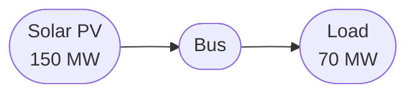

# Page templates

Copy the matching template when you start a new page. The principles behind them are in [SKILL.md](SKILL.md).

## Asset and market page template

````markdown
---
icon: lucide/zap
---

# Page title

One-sentence description of what this is and why it matters.

## Basic usage

\```python
from odys import ...

# Runnable, copy-pasteable code

\```

One-sentence explanation of what this does.

## Fields

| Field | Type | Required | Default | Description |
| ----- | ---- | -------- | ------- | ----------- |

## A feature

One concept, with prose and a runnable example. No equations.

See [G-7](../../formulation/generators.md#g-7) for how it's modelled.

## Profiles

The `Scenario` profile the asset takes, if any.

## Results

\```python
result = energy_system.optimize()
result.generators.power
\```

## How it's modelled

One or two sentences, then a link to the asset's [formulation page](../../formulation/generators.md).

## Next steps

The question the reader has now, and a link to [Related Page](related.md).
````

## Formulation page template

````markdown
---
icon: lucide/factory
---

# Model part

The question this page answers, in one or two everyday sentences. Then what it models and when it's added ("added for every `Generator` in the portfolio").

## Sets and indices

A short list, linking to [Notation and conventions](notation.md).

## Variables

One display block with every variable, its domain and bounds, each also named in words.

## Constraints

### G-7 · Output changes gradually {#g-7}

One plain sentence on what it enforces.

$$p_{g,s,t} - p_{g,s,t-1} \le R^{up}_g \quad \forall g \in \mathcal{G},\ s \in \mathcal{S},\ t \in \mathcal{T}$$

Read aloud: the equation in one everyday sentence.

**Why it looks like this.** What the optimizer would get away with without it, in two to four sentences.

**Good to know.** Limitations or redundancy, with the issue link, only when there is something.

`Added: always · Binds: when ramp_up is set · Name: generator_max_ramp_up_constraint`

## Power balance contribution

## Objective contribution

The term this part adds to the profit, linked to the [Objective](objective.md).

## Where to find each symbol in odys

| Symbol | Attribute | Type | Unit |
| ------ | --------- | ---- | ---- |

The bridge: the question the reader has now, and a link to the next page.

---

Implemented in [`odys.optimization.formulations.generator`](../developer/api/optimization/formulations/generator.md).
````

## Example page template

An example solves one problem with one script in `examples/`. It explains the problem and its results; the concepts it uses are linked to the User Guide and the math to the formulation (see §10 in [SKILL.md](SKILL.md)).

````markdown
---
icon: lucide/battery
---

# Example title

## Problem Description

The situation in everyday words: what the system has, and the question the optimizer answers. Link each asset type to its User Guide page instead of explaining it.



**Source**: [`examples/battery_dispatch.py`](https://github.com/ramirocrc/odys/blob/main/examples/battery_dispatch.py)

## Walkthrough

### 1. A step of the script

What this step adds to the problem, then its code. A feature the reader may not know gets a link, such as "the battery's [state of charge](../user_guide/assets/battery.md)", not an explanation.

## Results

The output, and what it means for this case: which asset does what, and why, in terms of this problem's numbers.

## Discussion

What the example shows, and the bridge to the next example.
````
