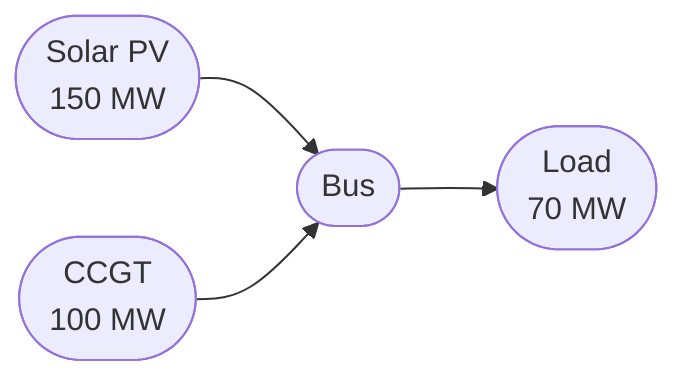

# Documentation guidelines

Principles for writing and improving the Odys documentation.

## 1. Make the Quickstart unbelievably good

This is the most important page. Someone should be able to install the package, copy 20-30 lines of code, see a useful result, and understand why it works -- within 5 minutes.

The quickstart lives on `index.md` as the "Quick example" section. The "Get started" button links to `user_guide/energy_system.md`, which expands on the same workflow.

The smallest example that makes someone think "now I get it" is not a toy. It is a realistic dispatch problem with a generator, a load, and a visible result:

```python
from datetime import timedelta

from odys import AssetPortfolio, EnergySystem, Generator, FixedLoad, LoadProfile, Scenario

generator = Generator(name="gen", nominal_power=100.0, variable_cost=50.0)
load = FixedLoad(name="demand")

portfolio = AssetPortfolio([generator, load])

energy_system = EnergySystem(
    portfolio=portfolio,
    scenarios=Scenario(profiles=(LoadProfile(load=load, values=[60, 90, 40, 70]),)),
    timestep=timedelta(hours=1),
    number_of_steps=4,
)

result = energy_system.optimize()
print(result.generators.power)
```

## 2. Tell a story instead of listing features

Follow the user's journey. Each page answers the next question a user naturally has:

1. What is this and how do I install it? (`index.md`)
2. How do I set up my first system? (`user_guide/energy_system.md`)
3. What assets can I model? (`generator.md`, `storage.md`, `load.md`)
4. How do I describe the data? (`scenario.md`)
5. How do I read the results? (`optimization.md`)
6. What if the future is uncertain? (`stochastic.md`)
7. Can I see a full worked example? (`examples/`)

Think in terms of "What is the user wondering now?" not "What feature should I describe?"

## 3. Every page should have runnable examples

Every page contains executable code. Not pseudocode. Real code.

Pattern:

1. Here is the problem.
2. Here is the solution.
3. Here is the output.
4. Here is what changed.

Someone can almost learn by scrolling.

## 4. Minimize prose, but anchor math with words

Odys is a mathematical library. Equations are a first-class part of the documentation, not something to hide. But every equation should be preceded by a short sentence that explains what it does and why it matters.

Instead of:

> The following constraint can optionally be applied to limit the generator output...

Write:

> The optimizer caps generator output at the available capacity for each timestep:
>
> $$p_{g,t,s} \le A_{g,t,s}$$

People skim. Examples and equations beat paragraphs.

## 5. One concept per section

Within a page, each `##` heading covers one idea. Across the site, each page has a clear focus.

A page like `generator.md` covers:

- Basic usage (one concept)
- Ramp constraints (one concept)
- Minimum up time (one concept)
- Startup cost (one concept)
- Results (one concept)

Each section is self-contained. A reader can jump to "Ramp constraints" without reading the rest.

## 6. Progressive disclosure

Beginners see:

```python
gen = Generator(name="gen", nominal_power=100.0, variable_cost=50.0)
```

Intermediate users learn:

```python
gen = Generator(
    name="gen",
    nominal_power=100.0,
    variable_cost=50.0,
    ramp_up=50.0,
    min_up_time=timedelta(hours=4),
)
```

Advanced users discover:

```python
gen = Generator(
    name="gen",
    nominal_power=100.0,
    variable_cost=50.0,
    ramp_up=50.0,
    min_up_time=timedelta(hours=4),
    startup_cost=500.0,
    min_power=20.0,
)
```

The docs never overwhelm. Complexity appears only when needed.

## 7. Have an opinion

Don't say "there are many ways." Say "use this." Then later: "if you need something more advanced..."

Opinionated documentation reduces cognitive load. For example:

> Use a single `Scenario` for deterministic problems. When you need to account for uncertainty, pass several scenarios, each with a `probability`.

## 8. Make examples realistic

Bad:

```python
x = Foo()
```

Good:

```python
solar = Generator(name="solar_pv", nominal_power=150.0, variable_cost=0.0)
load = FixedLoad(name="load")
scenario = Scenario(
    profiles=(
        AvailableCapacityProfile(generator=solar, values=[0, 30, 60, 80, 100, 80, 60, 30, 0]),
        LoadProfile(load=load, values=9 * [70]),
    ),
)
```

Someone working in energy optimization immediately recognizes the problem.

## 9. Use diagrams

Mermaid diagrams clarify system structure and data flow. Use them for:

**Asset topology** (as in `basic_dispatch.md`):



**Optimization workflow**:

```
Assets --> AssetPortfolio --> EnergySystem --> optimize() --> Results
```

**Object relationships**:

```
EnergySystem
 ├── AssetPortfolio
 │    ├── Generator
 │    ├── StationaryStorage
 │    ├── ElectricVehicle
 │    ├── Charger
 │    ├── FixedLoad
 │    └── FlexibleLoad
 ├── Scenario | Scenario[] (with probabilities)
 ├── initial_conditions / final_conditions (optional)
 └── EnergyMarket[] (optional)
```

Good diagrams replace pages of text.

## 10. Separate tutorials from reference

This is the Diataxis framework applied to Odys:

| Section       | Purpose                                 | Location                                            |
| ------------- | --------------------------------------- | --------------------------------------------------- |
| User Guide    | Teach concepts and walk through the API | `user_guide/`                                       |
| Examples      | Solve a specific problem end-to-end     | `examples/`                                         |
| API Reference | Exact signatures, types, and defaults   | `developer/api/`                                    |
| Explanation   | Why the library is designed this way    | `user_guide/` (mathematical_notation, optimization) |

Don't mix them. A user guide page teaches. An API page documents. An example page solves.

## 11. Explain the rationale

Don't just explain what. Explain why.

Instead of:

> The storage model uses binary charging mode variables.

Explain:

> A binary variable prevents the storage from charging and discharging simultaneously, which would be physically impossible and would create artificial efficiency losses in the model.

## 12. The user guide is primary; the API reference is secondary

The user guide teaches the workflow with runnable examples. The API reference (`developer/api/`) provides exact signatures for when the user needs details.

Most users should never need to read the API reference to use Odys. The user guide should be self-sufficient.

## 13. Write like you're pair programming

Instead of:

> The `EnergySystem` class encapsulates the optimization workflow...

Write:

> Let's set up our first energy system.
>
> Now let's optimize it.
>
> Notice how the solver uses solar first because it's free?

That conversational style keeps readers engaged.

## 14. Explain why Odys exists

The landing page should answer:

- What problem does Odys solve?
- What alternatives exist?
- Why is Odys different?
- Who is it for?
- Who is it not for?

Users appreciate honesty about scope and trade-offs.

## 15. End every page with the next step

Every page links forward. The reader never wonders where to go next.

Examples:

- End of `generator.md`: "Next, see how [Storage](storage.md) adds time-shifting to your portfolio."
- End of `scenario.md`: "Ready for uncertainty? See [Stochastic Optimization](stochastic.md)."
- End of an example: "This example used deterministic scenarios. The [CVaR Market Risk](../examples/cvar_market_risk.md) example adds risk-aware optimization."

## 16. Visual consistency

Every page follows the same template:

1. Frontmatter with icon
2. Title
3. Short introduction (1-2 sentences)
4. "See [Mathematical notation](mathematical_notation.md)" link (if math is involved)
5. Basic usage (runnable code)
6. Fields table (if applicable)
7. Detailed sections (one concept each)
8. Results section (how to read the output)
9. Next step link

Readers quickly learn the pattern.

## 17. Cross-link aggressively

Pages are not read in isolation. Link to related pages wherever a concept is introduced:

- "The key must match the `name` of a [Generator](generator.md) in your portfolio."
- "See [Stochastic Optimization](stochastic.md) for more details."
- "Market prices are specified in the [Scenario](scenario.md), not on the market object."

Internal links are the connective tissue of the documentation.

## 18. Use documentation-driven development

If documenting something is awkward, the API may be awkward too.

A useful test: could I explain this API to someone in three lines of code?

If not, the API itself may need refinement.

## Information architecture

```
docs/
├── index.md                  # Landing page + quickstart
│
├── user_guide/               # Tutorials and concept pages
│   ├── energy_system.md      # Main entry point
│   ├── generator.md          # Generator asset
│   ├── load.md               # FixedLoad and FlexibleLoad
│   ├── storage.md            # StationaryStorage
│   ├── electric_vehicle.md   # EV asset + Trip
│   ├── charger.md            # EV charger
│   ├── market.md             # Energy markets
│   ├── asset_portfolio.md    # Portfolio container
│   ├── scenario.md           # Scenarios and profiles
│   ├── initial_and_final_conditions.md
│   ├── optimization.md       # Objective, constraints, results
│   ├── solvers.md            # Solver choice and options
│   ├── stochastic.md         # Stochastic optimization
│   ├── mathematical_notation.md
│   └── multi_stage.md        # Multi-stage optimization
│
├── examples/                 # End-to-end worked examples
│   ├── index.md
│   ├── basic_dispatch.md
│   ├── battery_dispatch.md
│   ├── flexible_load_market.md
│   ├── market_arbitrage.md
│   ├── cvar_market_risk.md
│   └── ev_fleet_optimization.md
│
└── developer/                # Developer Reference
    ├── index.md              # Overview and package layers
    ├── data_model.md         # Class diagrams (checked by tests/test_architecture_docs.py)
    ├── sequences.md          # optimize() sequence diagram
    └── api/                  # API reference, one page per module (mkdocstrings)
```

## Page template

````markdown
---
icon: lucide/zap
---

# Page title

One-sentence description of what this is and why it matters.

See [Mathematical notation](mathematical_notation.md) for the full list of symbols used below.

## Basic usage

\```python
from odys import ...

# Runnable, copy-pasteable code

\```

One-sentence explanation of what this does.

## Fields

| Field | Type | Required | Default | Description |
| ----- | ---- | -------- | ------- | ----------- |

## Advanced usage

Additional examples, one concept per section.

## Results

\```python
result = energy_system.optimize()
result.generators.power
\```

## Next steps

See [Related Page](related.md) for ...
````
