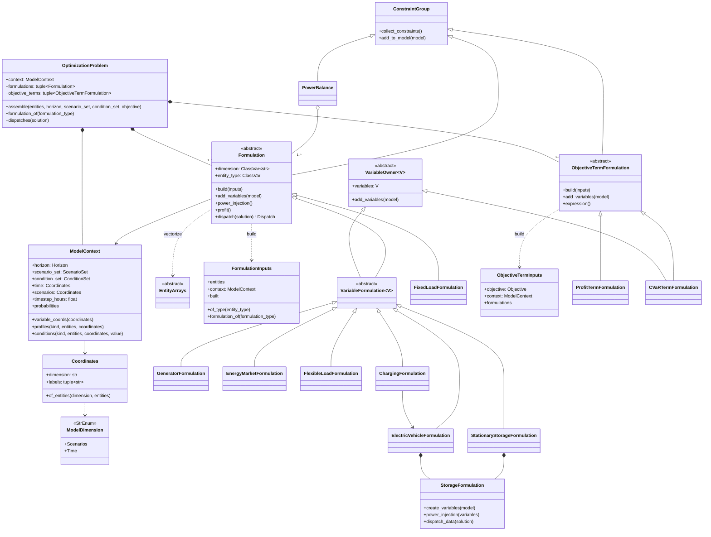
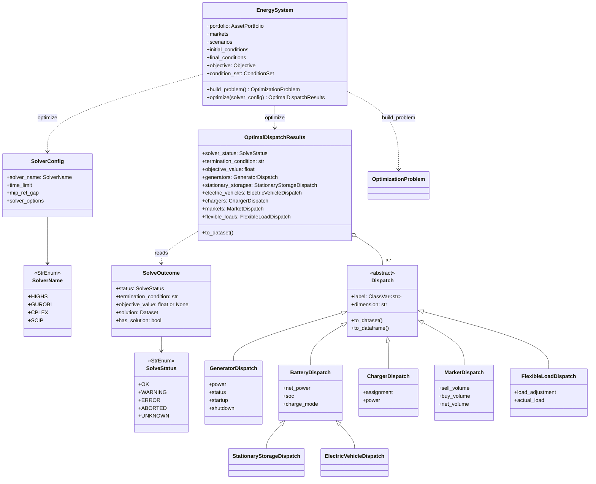

# Data model

The classes of each layer and how they relate. Each section links to the API reference of its packages; the [overview](index.md) shows how the layers depend on each other, and [sequence diagrams](sequences.md) shows how they interact during `optimize()`.

## Domain

The user-facing layer: pydantic models validated at construction. It imports nothing else from `odys` and no numerical library. API reference: [`odys.domain`](api/domain/index.md).

```mermaid
classDiagram
    class EnergyEntity {
        <<abstract>>
        +name: str
        +max_supply(conditions)
        +min_demand(conditions)
        +max_energy_supply(conditions)
        +validate_horizon(conditions)
    }
    class Asset {
        <<abstract>>
    }
    class Generator {
        +nominal_power
        +variable_cost
        +min_power
        +ramp_up
        +ramp_down
        +min_up_time
        +min_down_time
        +startup_cost
        +shutdown_cost
    }
    class Battery {
        <<value object>>
        +capacity
        +max_charge_power
        +max_discharge_power
        +efficiency_charging
        +efficiency_discharging
        +soc_min
        +soc_max
        +degradation_cost
        +self_discharge_rate
    }
    class StationaryStorage {
        +battery: Battery
    }
    class ElectricVehicle {
        +battery: Battery
        +trips: tuple~Trip~
    }
    class Trip {
        <<value object>>
        +start_time
        +end_time
        +energy_consumption
        +min_soc_at_departure
    }
    class Charger {
        +max_power
    }
    class FixedLoad
    class FlexibleLoad {
        +max_increase
        +max_decrease
        +value_of_consumption
    }
    class EnergyMarket {
        +max_trading_volume_per_step
        +allowed_trade_direction: AllowedTradeDirection
        +stage_fixed: bool
    }
    class AllowedTradeDirection {
        <<StrEnum>>
    }
    class AssetPortfolio {
        +assets: tuple~Asset~
        +get_asset(name) Asset
        +assets_of(asset_type) tuple
    }
    class Horizon {
        <<value object>>
        +timestep: timedelta
        +number_of_steps: int
        +hours_per_step: float
        +is_whole_steps(duration) bool
        +steps_in(duration) int
    }
    class OperatingConditions {
        <<value object>>
        +horizon: Horizon
        +profile_values
    }
    class Profile {
        <<abstract>>
        +entity_types: ClassVar
        +required: ClassVar
        +values: tuple~float~
        +entity: EnergyEntity
    }
    class LoadProfile {
        +load: FixedLoad or FlexibleLoad
    }
    class AvailableCapacityProfile {
        +generator: Generator
    }
    class PriceProfile {
        +market: EnergyMarket
    }
    class Scenario {
        +name: str
        +probability: float
        +profiles: tuple~Profile~
        +profiles_of(kind)
        +profile_for(kind, entity)
    }
    class ScenarioSet {
        +scenarios: tuple~Scenario~
        +names
    }
    class Condition {
        <<abstract>>
        +entity_types: ClassVar
        +entity: Asset
    }
    class InitialCondition {
        <<abstract>>
        +required_for(entity) str or None
    }
    class FinalCondition {
        <<abstract>>
    }
    class GeneratorInitialState {
        +generator: Generator
        +power: float
        +time_in_state: timedelta or None
        +is_on: bool
    }
    class GeneratorFinalState {
        +generator: Generator
        +power: float
    }
    class StorageInitialState {
        +storage: StationaryStorage
        +soc: float
    }
    class StorageFinalState {
        +storage: StationaryStorage
        +soc: float
    }
    class ElectricVehicleInitialState {
        +vehicle: ElectricVehicle
        +soc: float
    }
    class ElectricVehicleFinalState {
        +vehicle: ElectricVehicle
        +soc: float
    }
    class ConditionSet {
        +initial: tuple~InitialCondition~
        +final: tuple~FinalCondition~
        +conditions
        +get(kind, entity)
    }
    class ObjectiveTerm {
        <<abstract>>
        +weight: float
    }
    class ProfitTerm
    class CVaRTerm {
        +confidence_level: float
    }
    class Objective {
        +terms: tuple~ObjectiveTerm~
        +term_of(term_type)
    }

    EnergyEntity <|-- Asset
    EnergyEntity <|-- EnergyMarket
    Asset <|-- Generator
    Asset <|-- StationaryStorage
    Asset <|-- ElectricVehicle
    Asset <|-- Charger
    Asset <|-- FixedLoad
    Asset <|-- FlexibleLoad
    StationaryStorage *-- Battery
    ElectricVehicle *-- Battery
    ElectricVehicle *-- "0..*" Trip
    EnergyMarket --> AllowedTradeDirection
    AssetPortfolio o-- "0..*" Asset
    Profile <|-- LoadProfile
    Profile <|-- AvailableCapacityProfile
    Profile <|-- PriceProfile
    LoadProfile --> FixedLoad
    LoadProfile --> FlexibleLoad
    AvailableCapacityProfile --> Generator
    PriceProfile --> EnergyMarket
    Scenario *-- "0..*" Profile
    ScenarioSet *-- "1..*" Scenario
    OperatingConditions --> Horizon
    Condition <|-- InitialCondition
    Condition <|-- FinalCondition
    InitialCondition <|-- GeneratorInitialState
    InitialCondition <|-- StorageInitialState
    InitialCondition <|-- ElectricVehicleInitialState
    FinalCondition <|-- GeneratorFinalState
    FinalCondition <|-- StorageFinalState
    FinalCondition <|-- ElectricVehicleFinalState
    GeneratorInitialState --> Generator
    GeneratorFinalState --> Generator
    StorageInitialState --> StationaryStorage
    StorageFinalState --> StationaryStorage
    ElectricVehicleInitialState --> ElectricVehicle
    ElectricVehicleFinalState --> ElectricVehicle
    ConditionSet *-- "0..*" Condition
    ObjectiveTerm <|-- ProfitTerm
    ObjectiveTerm <|-- CVaRTerm
    Objective *-- "1..*" ObjectiveTerm
```

## Parameters and optimization

`OptimizationProblem.assemble` builds one `ModelContext` and every formulation whose entity type is present (`FORMULATIONS` order), then every objective term the objective holds (`OBJECTIVE_TERM_FORMULATIONS`). Each formulation vectorizes its entities into its `EntityArrays` subclass with `vectorize`, reads scenario profiles (`context.profiles`) and the run's initial and final conditions (`context.conditions`) through the context, owns its variables, constraints, power injection, profit and results view, and names its own entity axis. `build_model` adds variables, every `ConstraintGroup`'s constraints and `PowerBalance`, and maximizes the sum of the objective-term expressions. API reference: [`odys.parameters`](api/parameters/index.md), [`odys.optimization`](api/optimization/index.md).

## Solving and results

`solve` takes a `linopy.Model` and returns a `SolveOutcome` with an odys-owned status. Whether a solution exists is `has_solution`, not the status: linopy reports `ok` for a time limit reached before the first feasible solution. `OptimalDispatchResults` builds the dispatches from the outcome only when there is a solution, squeezes a single scenario once, and serves one typed property per entity type. API reference: [`odys.solvers`](api/solvers/index.md), [`odys.results`](api/results/index.md), [`odys.energy_system`](api/energy_system.md).

