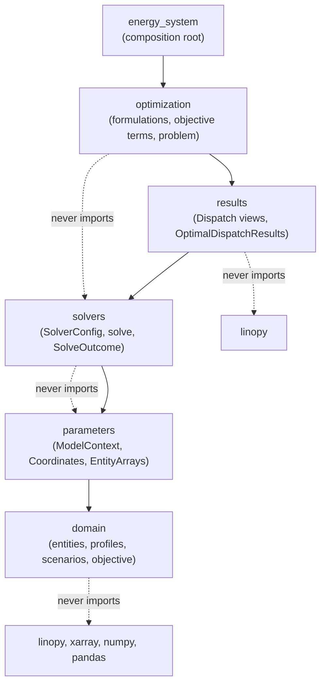

# Developer Reference

How odys is put together, from the public import surface down to the internals. It is meant for contributors and for users who want the details behind the [user guide](../user_guide/model/first_model.md); building and optimizing a system needs only the user guide.

## Start here

The public API is what `import odys` gives you:

- [`odys`](api/odys.md): top-level exports and the main import path
- [`odys.energy_system`](api/energy_system.md): building and optimizing a system
- [`odys.domain`](api/domain/index.md): asset, scenario, objective and validation models
- [`odys.results`](api/results/index.md): optimization outputs and dispatch data

The internal packages turn a validated system into a solved model: [`odys.parameters`](api/parameters/index.md), [`odys.optimization`](api/optimization/index.md) and [`odys.solvers`](api/solvers/index.md).

## Explore

- [Data model](data_model.md): the classes of each layer and how they relate
- [Sequence diagrams](sequences.md): what happens during `EnergySystem.optimize()`
- [API reference](api/odys.md): every module, generated from the docstrings

## Package layers

Packages import only lower layers. import-linter enforces this (`[tool.importlinter]` in `pyproject.toml`, part of `just check`), together with the forbidden imports drawn as dashed lines.

## Keeping the diagrams current

`tests/test_architecture_docs.py` compares the class diagrams of the [data model](data_model.md) and the sequence diagram of the [`optimize()` pipeline](sequences.md) with the code in `src/odys`, so `just test` fails when they drift apart. For the class diagrams it checks that:

- every **public** class (`odys.__all__`) and every **core model** class appears in a diagram. Core classes are the extension-point bases (`EnergyEntity`, `Profile`, `ObjectiveTerm`, `Formulation`, `ObjectiveTermFormulation`, `Dispatch`) with every class derived from them, plus the pipeline classes listed in the test (`ModelContext`, `OptimizationProblem`, `SolveOutcome`, …). Exceptions, typed variables objects, concrete `*Arrays` classes and solver option translators are left out;
- every class a diagram names is defined in `src/odys`;
- every `Base <|-- Subclass` edge is real inheritance;
- every `+member` listed in a class body exists on that class or one of its bases.

For the pipeline sequence diagram it checks that:

- every `participant` is a class or a module-level function in `src/odys` (`actor` marks an outside caller, such as `User`, that is not checked);
- every `A->>B: name(args)` call is a method of `B`, its constructor (`name` is the class name) or, when `B` is a function, the function itself;
- every argument written as a plain name is a parameter of the callee. Expressions such as `problem.dispatches` and replies (`-->>`) are prose.

For the user-guide diagram it checks that every node names a public class, and that the `Assets` subgraph lists every concrete `Asset` subclass, so a new asset type must be added there.

When the test fails, update the diagram, not the test: add the new class (a new asset type adds its entity, formulation and dispatch), or rename or remove the stale one. Keep members to the names a reader needs; instance attributes set in `__init__` are not visible to the check, so list them in the prose instead.
