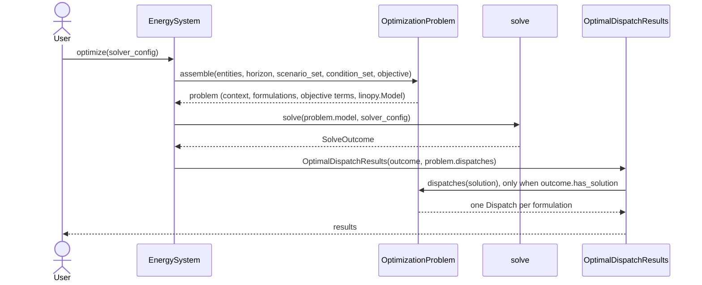

# Sequence diagrams

How the layers of the [data model](data_model.md) interact at run time.

## Pipeline

`EnergySystem.optimize()` is three calls: build the problem and its model, solve the model, wrap the outcome.

Participants: [`EnergySystem`](api/energy_system.md), [`OptimizationProblem`](api/optimization/problem.md), [`solve`](api/solvers/solver.md), [`OptimalDispatchResults`](api/results/optimization_results.md).

