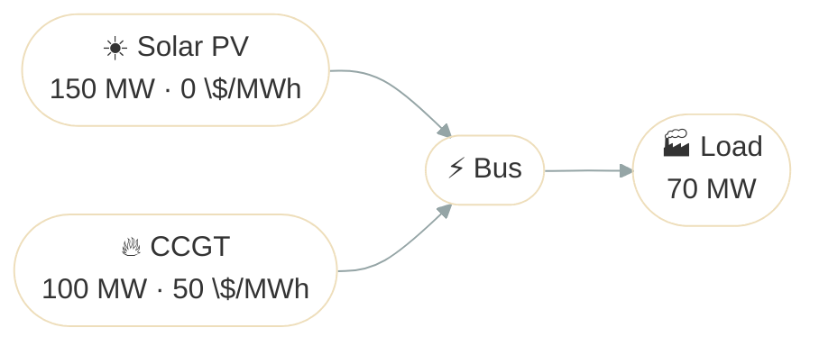

# Basic Dispatch

## Problem Description

A site has to serve a constant 70 MW load over a day, in hourly steps. It has two units: a 150 MW solar farm, free to run but limited by the sun, and a 100 MW CCGT at 50 $/MWh. There's no storage and no market. The question is the merit order: how much of the load solar can cover at each hour, and how much the CCGT has to make up.



**Source**: [`examples/basic_dispatch.py`](https://github.com/ramirocrc/odys/blob/main/examples/basic_dispatch.py). The script wraps the steps below in `run_basic_dispatch()`, which returns the results.

## Walkthrough

### 1. Define the assets

Two [generators](../user_guide/assets/generator.md) and a [fixed load](../user_guide/assets/fixed_load.md), in one portfolio:

```python
from datetime import timedelta

from odys import (
    AssetPortfolio,
    AvailableCapacityProfile,
    EnergySystem,
    FixedLoad,
    Generator,
    LoadProfile,
    Scenario,
)

ccgt = Generator(
    name="ccgt",
    nominal_power=100,
    variable_cost=50,
)
solar_pv = Generator(
    name="solar_pv",
    nominal_power=150,
    variable_cost=0,
)
load = FixedLoad(
    name="load",
)
portfolio = AssetPortfolio([ccgt, solar_pv, load])
```

### 2. Describe the day

The solar farm's [available capacity](../user_guide/model/scenario.md#each-one-is-a-profile) follows the sun: zero at night, up to 125 MW at noon, below its 150 MW rating all day. The CCGT has no profile, so it can run up to its nominal power at every step. The load is 70 MW throughout:

```python
scenario = Scenario(
    profiles=(
        AvailableCapacityProfile(
            generator=solar_pv,
            values=[0, 0, 0, 0, 0, 0, 10, 30, 60, 90, 110, 120, 125, 120, 110, 90, 60, 30, 10, 0, 0, 0, 0, 0],
        ),
        LoadProfile(load=load, values=24 * [70]),
    ),
)
```

### 3. Solve

Twenty-four hourly steps:

```python
energy_system = EnergySystem(
    portfolio=portfolio,
    timestep=timedelta(hours=1),
    number_of_steps=24,
    scenarios=scenario,
)

result = energy_system.optimize()
```

## Results

The chart shows the dispatch as stacked bars, with the available solar capacity and the load as dashed lines:

<iframe src="../assets/plots/basic_dispatch.html" style="width:100%; height:500px; border:none;" loading="lazy"></iframe>

Solar runs first whenever the sun is up, because it's free, and the CCGT covers the rest:

- **Steps 0 to 5 and 19 to 23:** no sun, so the CCGT carries the full 70 MW.
- **Steps 6 to 8 and 16 to 18:** solar covers part of the load, and the CCGT fills the gap, from 60 MW down to 10 MW and back.
- **Steps 9 to 15:** solar could produce more than 70 MW, so it covers the whole load, the CCGT is off, and the surplus is curtailed.

Over the day, solar delivers 690 MWh of the 965 MWh it could have produced, so 275 MWh is curtailed. The CCGT produces 990 MWh, and its fuel cost of 49,500 is the whole objective: `result.objective_value` is −49,500. Print `result.generators.power` to see the numbers step by step; see [Results](../user_guide/solving/results.md) for how to read them.

## Discussion

The dispatch follows the merit order, step by step: each hour is solved on its own terms, because nothing links one hour to the next. That's also why 275 MWh of free energy goes to waste at midday while the CCGT burns gas every evening. The [Battery Dispatch](battery_dispatch.md) example adds storage to move that surplus into the evening.
