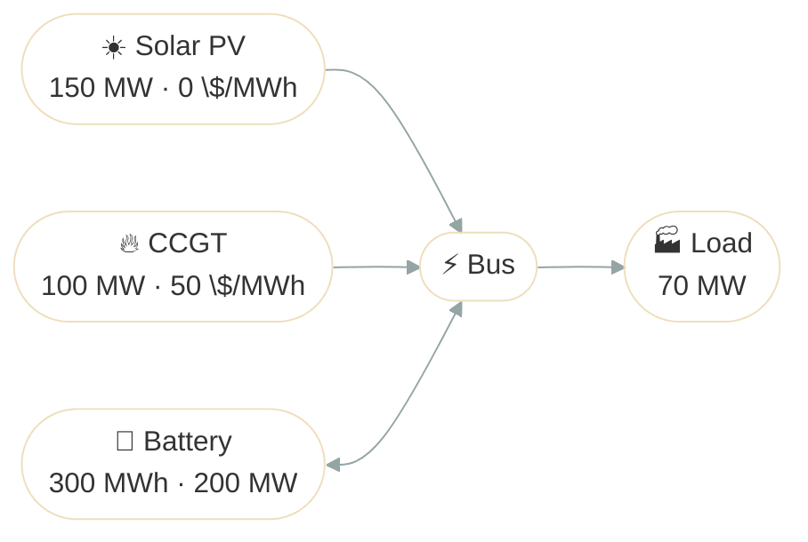

# Battery Dispatch

## Problem Description

The site of [Basic Dispatch](basic_dispatch.md) wastes 275 MWh of solar at midday and burns gas all evening. This example adds a 300 MWh battery that can charge or discharge at up to 200 MW, 95 % efficient each way, starting and ending the day empty. The question is how much of the midday surplus is worth storing, and how much gas it saves in the evening.



**Source**: [`examples/battery_dispatch.py`](https://github.com/ramirocrc/odys/blob/main/examples/battery_dispatch.py). The script wraps the steps below in `run_battery_dispatch()`, which returns the results.

## Walkthrough

### 1. Define the assets

The two [generators](../user_guide/assets/generator.md) and the [fixed load](../user_guide/assets/fixed_load.md) of Basic Dispatch, plus a [stationary storage](../user_guide/assets/stationary_storage.md) holding a [battery](../user_guide/assets/battery.md). Its [efficiencies](../user_guide/assets/battery.md#efficiency) mean that of every MWh stored, about 0.9 MWh comes back:

```python
from datetime import timedelta

from odys import (
    AssetPortfolio,
    AvailableCapacityProfile,
    Battery,
    EnergySystem,
    FixedLoad,
    Generator,
    LoadProfile,
    Scenario,
    StationaryStorage,
    StorageFinalState,
    StorageInitialState,
)

ccgt = Generator(
    name="ccgt",
    nominal_power=100,
    variable_cost=50,
)
solar_pv = Generator(
    name="solar_pv",
    nominal_power=150,
    variable_cost=0,
)
load = FixedLoad(
    name="load",
)

battery = StationaryStorage(
    name="battery",
    battery=Battery(
        capacity=300,
        max_charge_power=200,
        max_discharge_power=200,
        efficiency_charging=0.95,
        efficiency_discharging=0.95,
    ),
)
portfolio = AssetPortfolio([ccgt, solar_pv, load, battery])
```

### 2. Describe the day

The same day as in Basic Dispatch: the solar farm's [available capacity](../user_guide/model/profiles.md) follows the sun, and the load is 70 MW throughout. The battery takes no profile:

```python
SOLAR_PROFILE: list[float] = [0, 0, 0, 0, 0, 0, 10, 30, 60, 90, 110, 120, 125, 120, 110, 90, 60, 30, 10, 0, 0, 0, 0, 0]
LOAD_PROFILE: list[float] = 24 * [70.0]

scenario = Scenario(
    profiles=(
        AvailableCapacityProfile(generator=solar_pv, values=SOLAR_PROFILE),
        LoadProfile(load=load, values=LOAD_PROFILE),
    ),
)
```

### 3. Solve

The battery starts and ends the day empty. These are [initial and final conditions](../user_guide/model/first_model.md#initial-and-final-conditions) of the run, so every MWh it delivers has to come from that day's solar:

```python
energy_system = EnergySystem(
    portfolio=portfolio,
    timestep=timedelta(hours=1),
    number_of_steps=24,
    scenarios=scenario,
    initial_conditions=(StorageInitialState(storage=battery, soc=0.0),),
    final_conditions=(StorageFinalState(storage=battery, soc=0.0),),
)

result = energy_system.optimize()
```

## Results

The top chart shows the dispatch, with the battery's discharge as positive bars and its charging as negative ones. The bottom chart shows its state of charge:

<iframe src="../assets/plots/battery_dispatch.html" style="width:100%; height:1000px; border:none;" loading="lazy"></iframe>

- **Steps 0 to 8:** the battery is empty and stays so. The CCGT and the rising sun serve the load, as in Basic Dispatch. Charging from the CCGT would only lose energy, since gas costs the same at every hour.
- **Steps 9 to 15:** solar exceeds the load, and the battery stores all of the surplus, up to 55 MW at step 12. It fills to 87 % of its capacity, and no solar is curtailed.
- **Steps 16 to 23:** the battery returns what it stored, and the CCGT covers the rest of the load until the battery is empty again at the end of the day.

The battery stores 275 MWh and gives back 248 MWh; the other 27 MWh is lost to its efficiencies. The CCGT produces 742 MWh instead of 990, so the objective improves from −49,500 to −37,091. In the evening, gas costs the same at every hour, so any split of those hours between the battery and the CCGT costs the same: the solver returns one of them, and the chart shows it. `result.stationary_storages.net_power` is positive while the battery charges; see [Results](../user_guide/assets/battery.md#results) on the Battery page for how to read it.

## Discussion

Storage links one hour to the next: the battery moves the midday surplus into the evening, and the losses are worth paying because the energy it replaces costs 50 $/MWh. Since the CCGT costs the same at every hour, it doesn't matter when in the evening the battery discharges. The [Flexible Load Market](flexible_load_market.md) example replaces the generators with a market whose price changes through the day, and a load that adjusts its consumption to it.
