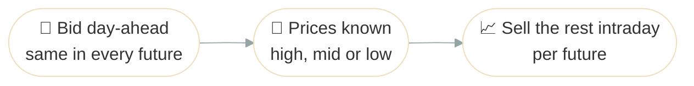

# Day-Ahead or Intraday

## Problem Description

A 100 MW CCGT at 120 $/MWh sells one hour's output on two markets: day-ahead (SDAC), where it bids before it knows the prices, and intraday (SIDC), where it sells once they're known. Intraday is simplified to one trade made with the prices known. Three futures are equally likely. Both markets rise and fall together, but day-ahead moves little, from 190 to 210 $/MWh, while intraday swings from 140 to 280. The question is how much to commit day-ahead, first to maximize expected profit, then when a bad outcome weighs more than a good one.



**Source**: [`examples/day_ahead_or_intraday.py`](https://github.com/ramirocrc/odys/blob/main/examples/day_ahead_or_intraday.py). The script wraps the steps below in `run_day_ahead_or_intraday()`, which returns both results.

## Walkthrough

### 1. Define the plant and the markets

A [generator](../user_guide/assets/generator.md) and two sell-only [markets](../user_guide/markets/energy_market.md#trade-direction). Day-ahead is [stage-fixed](../user_guide/markets/energy_market.md#stage-fixed-markets): its volume is decided before the uncertainty, so it's the same in every scenario. Intraday adapts to each one:

```python
from datetime import timedelta

from odys import (
    AllowedTradeDirection,
    AssetPortfolio,
    CVaRTerm,
    EnergyMarket,
    EnergySystem,
    Generator,
    Objective,
    PriceProfile,
    ProfitTerm,
    Scenario,
)

CCGT_VARIABLE_COST = 120.0
SCENARIO_PRICES: dict[str, dict[str, float]] = {
    "high": {"day_ahead": 210, "intraday": 280},
    "mid": {"day_ahead": 200, "intraday": 200},
    "low": {"day_ahead": 190, "intraday": 140},
}

ccgt = Generator(name="ccgt", nominal_power=100.0, variable_cost=CCGT_VARIABLE_COST)

portfolio = AssetPortfolio([ccgt])

day_ahead = EnergyMarket(
    name="day_ahead",
    max_trading_volume_per_step=150,
    stage_fixed=True,
    allowed_trade_direction=AllowedTradeDirection.SELL_ONLY,
)
intraday = EnergyMarket(
    name="intraday",
    max_trading_volume_per_step=100,
    allowed_trade_direction=AllowedTradeDirection.SELL_ONLY,
)
```

### 2. Describe the three futures

One [scenario](../user_guide/uncertainty/scenarios.md) per future, each with a probability of 1/3 and its own price for each market. The scenarios are named after the intraday price:

```python
scenarios = [
    Scenario(
        name=name,
        probability=1 / len(SCENARIO_PRICES),
        profiles=(
            PriceProfile(market=day_ahead, values=[prices["day_ahead"]]),
            PriceProfile(market=intraday, values=[prices["intraday"]]),
        ),
    )
    for name, prices in SCENARIO_PRICES.items()
]
```

### 3. Solve with and without CVaR

The same system twice, with one hourly step. The first run maximizes expected profit only. The second adds a [CVaR term](../user_guide/uncertainty/risk.md) with a weight of 1 and a confidence level of 0.6:

```python
energy_system_max_expected_profit = EnergySystem(
    portfolio=portfolio,
    markets=[day_ahead, intraday],
    scenarios=scenarios,
    number_of_steps=1,
    timestep=timedelta(hours=1),
    objective=Objective(terms=(ProfitTerm(weight=1),)),
)
result_max_expected_profit = energy_system_max_expected_profit.optimize()

energy_system_penalized_cvar = EnergySystem(
    portfolio=portfolio,
    markets=[day_ahead, intraday],
    scenarios=scenarios,
    number_of_steps=1,
    timestep=timedelta(hours=1),
    objective=Objective(
        terms=(
            ProfitTerm(weight=1),
            CVaRTerm(weight=1, confidence_level=0.6),
        ),
    ),
)
result_penalized_cvar = energy_system_penalized_cvar.optimize()
```

## Results

The chart shows what the CCGT sells on each market, in each scenario, for both runs:

<iframe src="../assets/plots/day_ahead_or_intraday.html" style="width:100%; height:500px; border:none;" loading="lazy"></iframe>

- **Expected profit only:** all 100 MW goes to intraday, in every scenario. `result_max_expected_profit.objective_value` is 8,667.
- **With CVaR:** all 100 MW goes day-ahead. The day-ahead volume is the same in every scenario because the market is stage-fixed. `result_penalized_cvar.objective_value` is 15,167: the expected profit plus the CVaR, each with a weight of 1.

The profit of each allocation in each scenario shows why:

| Day-ahead / intraday | high   | mid   | low   | Expected profit | CVaR  | Objective with CVaR |
| -------------------- | ------ | ----- | ----- | --------------- | ----- | ------------------- |
| 100 / 0 MW           | 9,000  | 8,000 | 7,000 | 8,000           | 7,167 | 15,167              |
| 0 / 100 MW           | 16,000 | 8,000 | 2,000 | 8,667           | 3,000 | 11,667              |
| 50 / 50 MW           | 12,500 | 8,000 | 4,500 | 8,333           | 5,083 | 13,417              |

Intraday pays more on average, 206.67 against 200 $/MWh, so the first run sells everything there. But it also falls further: in the low scenario it pays 140, where day-ahead still pays 190. With a confidence level of 0.6, the CVaR is the average profit over the worst 40 % of outcomes: all of the low scenario and part of the mid one. Each MW moved from intraday to day-ahead loses 6.67 of expected profit and adds 50 to the low scenario's profit, so the second run moves all of it. It gives up 667 of expected profit, and its worst scenario earns 7,000 instead of 2,000. See [Risk (CVaR)](../user_guide/uncertainty/risk.md#choosing-the-confidence-level-and-the-weight) for how the confidence level and weight change this, and the [formulation](../formulation/objective.md#conditional-value-at-risk) for how CVaR is computed.

## Discussion

Maximizing expected profit bets everything on the market with the best average, however badly it can go. Adding CVaR makes the optimizer pay for the worst outcomes, so it commits to the steadier market. Here the two markets move together, and day-ahead pays more than intraday in the worst scenario whatever the split, so the answer is all or nothing: with a CVaR weight above 0.16, everything goes day-ahead; below it, everything goes intraday. A mix would only pay off if the worst scenario changed with the split. The [Depot Charging with V2G](depot_charging.md) example returns to a single future, with vehicles, trips and chargers.
