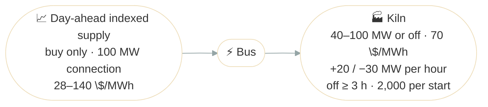

# Industrial Demand Response

## Problem Description

A cement kiln buys all its power on a supply contract indexed to the day-ahead (SDAC) price. Once day-ahead has cleared on the day before, the site knows every price of the next day, and plans the kiln's consumption against them. Each MWh the kiln consumes is worth 70 $/MWh to the site, and the grid connection carries at most 100 MW.

A kiln isn't a dial you can turn freely. It runs between 40 and 100 MW, or not at all: below its minimum stable load it has to stop. It heats up slowly, by at most 20 MW an hour, and cools down by at most 30 MW an hour. Once stopped, it stays off for at least 3 hours, and each restart costs 2,000. At midnight it's running at 40 MW.

The question is how much the kiln should draw each hour, and when it should stop. To see what the kiln's physics costs, we also plan the same day for an ideal kiln that can jump to any load and stop or restart for free.

Day-ahead clears in 15-minute steps; to keep the tables short, this example uses hourly prices.



**Source**: [`examples/demand_response.py`](https://github.com/ramirocrc/odys/blob/main/examples/demand_response.py). The script wraps the steps below in `run_demand_response()`, which returns both plans.

## Walkthrough

### 1. Define the supply and the kiln

The supply is a buy-only [market](../user_guide/markets/energy_market.md#trade-direction) whose [volume limit](../user_guide/markets/energy_market.md#volume-limit) is the grid connection. The kiln is a [flexible load](../user_guide/assets/flexible_load.md) with [ramp limits](../user_guide/assets/flexible_load.md#ramp-limits) and a `Commitment` that lets it [switch on and off](../user_guide/assets/flexible_load.md#switching-on-and-off):

```python
from datetime import timedelta

from odys import (
    AllowedTradeDirection,
    AssetPortfolio,
    Commitment,
    EnergyMarket,
    EnergySystem,
    FlexibleLoad,
    FlexibleLoadInitialState,
    FlexibleLoadProfile,
    PriceProfile,
    Scenario,
)

supply = EnergyMarket(
    name="supply",
    max_trading_volume_per_step=100.0,
    allowed_trade_direction=AllowedTradeDirection.BUY_ONLY,
)

kiln = FlexibleLoad(
    name="kiln",
    value_of_consumption=70.0,
    ramp_up=20.0,
    ramp_down=30.0,
    commitment=Commitment(min_down_time=timedelta(hours=3), startup_cost=2000.0),
)
```

### 2. Describe the day

While it runs, the kiln draws between 40 and 100 MW, its [range](../user_guide/assets/flexible_load.md#profiles). The day-ahead prices are cheap at night and around midday, with a short morning peak and a long evening one:

```python
day_ahead_prices = [52, 48, 45, 44, 46, 62, 88, 92, 66, 64, 62, 35, 30, 28, 32, 40, 60, 95, 120, 140, 130, 100, 60, 50]

scenario = Scenario(
    profiles=(
        FlexibleLoadProfile(load=kiln, lower_bound=24 * [40.0], upper_bound=24 * [100.0]),
        PriceProfile(market=supply, values=day_ahead_prices),
    ),
)
```

### 3. Solve

The kiln's ramps and its restart cost depend on where it starts, so it takes an [initial state](../user_guide/assets/flexible_load.md#initial-state): running at 40 MW.

```python
energy_system = EnergySystem(
    portfolio=AssetPortfolio(assets=[kiln]),
    markets=supply,
    timestep=timedelta(hours=1),
    number_of_steps=24,
    scenarios=scenario,
    initial_conditions=(FlexibleLoadInitialState(load=kiln, power=40.0),),
)

result = energy_system.optimize()
```

The script solves the same day a second time for the ideal kiln, `FlexibleLoad(name="kiln", value_of_consumption=70.0, commitment=Commitment())`: no ramps, no minimum down time, and free restarts.

## Results

The top chart shows both kilns' consumption between their 40 MW floor and 100 MW ceiling. The bottom chart shows the day-ahead price against the 70 $/MWh each MWh is worth:

<iframe src="../assets/plots/demand_response.html" style="width:100%; height:700px; border:none;" loading="lazy"></iframe>

The ideal kiln follows the [value of consumption](../user_guide/assets/flexible_load.md#value-of-consumption) hour by hour: 100 MW whenever power costs less than 70 $/MWh, off whenever it costs more. The real kiln can't, and its plan links the hours together:

- **Hours 0 to 2:** it climbs from 40 MW to 100 MW as fast as its ramp allows, 20 MW an hour.
- **Hours 5 to 7:** the morning peak is coming, and the kiln can only cool down 30 MW an hour, so it already drops to 70 MW at hour 5, while power is still cheap. It then runs at its 40 MW floor through the two dear hours, losing 1,600. Stopping instead would mean staying off for 3 hours, missing cheap power at hour 8, and paying 2,000 to restart: that costs more.
- **Hours 8 to 10:** it climbs back to 100 MW, 20 MW an hour.
- **Hours 17 to 21:** the evening peak is long and dear. Running at its floor through it would lose 9,400, far more than a restart, so the kiln stops at once.
- **Hours 22 and 23:** it restarts straight at 100 MW. A start isn't held back by the ramp, and the two cheap hours are worth 3,000, more than the 2,000 restart.

`result.objective_value` is 31,320 for the kiln, against 36,600 for the ideal kiln: the kiln's physics costs 5,280 on this day. The restart is 2,000 of it, the morning peak at the floor 1,600, and the slow ramps the other 1,680. The series are in `result.flexible_loads` (`consumption`, `status`, `startup` and `shutdown`) and `result.markets`; see [Results](../user_guide/assets/flexible_load.md#results) on the FlexibleLoad page.

## Discussion

Without its physics, a flexible load is a price threshold: consume when power is worth more than it costs. Ramps, a minimum stable load and the cost of a restart make each hour depend on its neighbours: the kiln slows down before a peak, rides out a short one, and stops only for a long one. That is where an optimizer earns its keep. The rules are written out in [FL-1 to FL-4](../formulation/flexible_loads.md#constraints).

The kiln only buys. The [Make or Buy](make_or_buy.md) example adds a CCGT next to the market, so the site chooses at each hour between producing, buying and selling.
