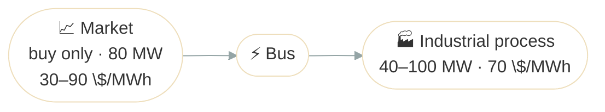

# Industrial Demand Response

## Problem Description

An industrial process can run anywhere from 40 to 100 MW, and buys all its power from a market whose price moves between 30 and 90 $/MWh over the day. Each MWh it consumes is worth 70 $/MWh to it. The market only sells to the site, at most 80 MW per step. The question is how much the process should consume at each hour.



**Source**: [`examples/demand_response.py`](https://github.com/ramirocrc/odys/blob/main/examples/demand_response.py). The script wraps the steps below in `run_demand_response()`, which returns the results.

## Walkthrough

### 1. Define the market and the process

A buy-only [market](../user_guide/markets/energy_market.md#trade-direction) with a [volume limit](../user_guide/markets/energy_market.md#volume-limit), and a [flexible load](../user_guide/assets/flexible_load.md). The market isn't an asset, so the portfolio holds only the process:

```python
from datetime import timedelta

from odys import (
    AllowedTradeDirection,
    AssetPortfolio,
    EnergyMarket,
    EnergySystem,
    FlexibleLoad,
    FlexibleLoadProfile,
    PriceProfile,
    Scenario,
)

market = EnergyMarket(
    name="market",
    max_trading_volume_per_step=80,
    allowed_trade_direction=AllowedTradeDirection.BUY_ONLY,
)

industrial_process = FlexibleLoad(name="industrial_process", value_of_consumption=70)

portfolio = AssetPortfolio(assets=[industrial_process])
```

### 2. Describe the day

The process can run anywhere from 40 to 100 MW at every step, its [range](../user_guide/assets/flexible_load.md#profiles), and the market's [price profile](../user_guide/markets/energy_market.md#profiles) is low around midday and high in the morning and evening:

```python
scenario = Scenario(
    profiles=(
        FlexibleLoadProfile(load=industrial_process, lower_bound=24 * [40], upper_bound=24 * [100]),
        PriceProfile(
            market=market,
            values=[80, 75, 72, 65, 60, 55, 50, 45, 40, 35, 30, 35, 40, 45, 50, 55, 60, 72, 80, 90, 85, 80, 75, 72],
        ),
    ),
)
```

### 3. Solve

The market goes in `markets`, next to the portfolio:

```python
energy_system = EnergySystem(
    portfolio=portfolio,
    markets=market,
    timestep=timedelta(hours=1),
    number_of_steps=24,
    scenarios=scenario,
)

result = energy_system.optimize()
```

## Results

The top chart shows the process's consumption within its 40 to 100 MW range. The bottom chart shows the market price against the 70 $/MWh the process's consumption is worth:

<iframe src="../assets/plots/demand_response.html" style="width:100%; height:700px; border:none;" loading="lazy"></iframe>

At each step, the optimizer compares the price with the [value of consumption](../user_guide/assets/flexible_load.md#value-of-consumption):

- **Steps 3 to 16** (30 to 65 $/MWh): power is worth more than it costs, so the process consumes as much as it can. It could take 100 MW, but the market sells at most 80, so it runs at 80 MW.
- **Steps 0 to 2 and 17 to 23** (72 to 90 $/MWh): power costs more than it's worth, so the process drops to its 40 MW lower bound.

Over the day, the process consumes 1,520 MWh, all bought from the market. `result.objective_value` is 21,960: the 106,400 the consumption is worth at 70 $/MWh, less 84,440 of purchases. The series are in `result.flexible_loads` (`consumption`) and `result.markets`; see [Results](../user_guide/assets/flexible_load.md#results) on the FlexibleLoad page.

## Discussion

A flexible load is dispatched like a generator in reverse: it consumes whenever power is worth more to it than it costs, within its range and what the market can deliver. Each step is decided on its own, so energy not used in the evening isn't made up at midday. The [Make or Buy](make_or_buy.md) example adds a CCGT next to the market, so the site chooses at each hour between producing and buying.
