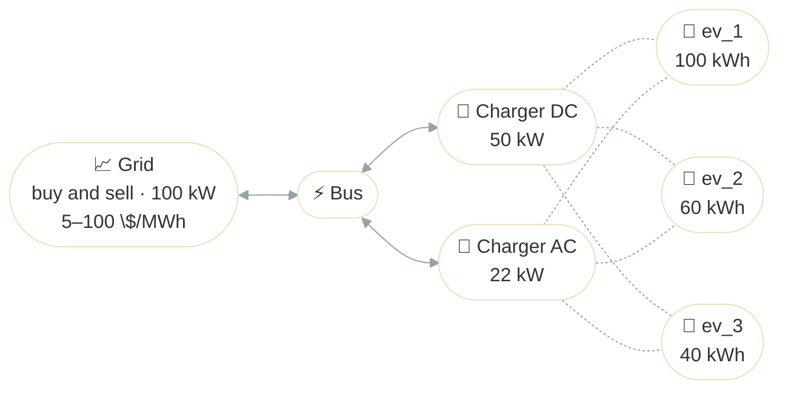

# Depot Charging with V2G

## Problem Description

A delivery depot runs three electric vans on staggered trips through the day, with two chargers between them. It buys power from the grid at a time-of-use price, from 5 $/MWh overnight to 100 $/MWh at the evening peak, and every van can sell power back (V2G). Each van has to leave on every trip with enough charge, and end the day at a set state of charge. The question is when each van charges, when it sells, and which charger it uses, when three vans share two chargers.

| Van    | Battery | Charge / V2G | Trips | Start → end of day |
| ------ | ------- | ------------ | ----- | ------------------ |
| `ev_1` | 100 kWh | 22 / 11 kW   | 3     | 80 % → 30 %        |
| `ev_2` | 60 kWh  | 22 / 11 kW   | 3     | 50 % → 60 %        |
| `ev_3` | 40 kWh  | 7 / 7 kW     | 2     | 50 % → 50 %        |



The dashed lines are the possible connections. At each step, a charger serves at most one van.

**Source**: [`examples/depot_charging.py`](https://github.com/ramirocrc/odys/blob/main/examples/depot_charging.py). The script defines the fleet at module level, and wraps the rest in `run_depot_charging()`, which returns the results.

## Walkthrough

### 1. Define the vans

Each van is an [electric vehicle](../user_guide/assets/electric_vehicle.md) with a battery and its [trips](../user_guide/assets/electric_vehicle.md#trips). A `max_discharge_power` above 0 lets it sell power back ([V2G](../user_guide/assets/electric_vehicle.md#vehicle-to-grid-v2g)). odys works in MW and MWh, so 22 kW is `0.022` (see [Time and units](../user_guide/model/time_and_units.md)):

```python
from datetime import timedelta

from odys import (
    AssetPortfolio,
    Battery,
    Charger,
    ElectricVehicle,
    ElectricVehicleFinalState,
    ElectricVehicleInitialState,
    EnergyMarket,
    EnergySystem,
    PriceProfile,
    Scenario,
    Trip,
)

ev_1 = ElectricVehicle(
    name="ev_1",
    battery=Battery(
        capacity=0.100,  # 100 kWh
        max_charge_power=0.022,  # 22 kW
        max_discharge_power=0.011,  # 11 kW V2G
    ),
    trips=(
        Trip(
            name="morning_delivery",
            start_time=timedelta(hours=7),
            end_time=timedelta(hours=9),
            energy_consumption=0.015,  # 15 kWh
            min_soc_at_departure=0.6,
        ),
        Trip(
            name="midday_delivery",
            start_time=timedelta(hours=11),
            end_time=timedelta(hours=12),
            energy_consumption=0.010,  # 10 kWh
            min_soc_at_departure=0.4,
        ),
        Trip(
            name="afternoon_delivery",
            start_time=timedelta(hours=14),
            end_time=timedelta(hours=16),
            energy_consumption=0.012,  # 12 kWh
            min_soc_at_departure=0.3,
        ),
    ),
)

ev_2 = ElectricVehicle(
    name="ev_2",
    battery=Battery(
        capacity=0.060,  # 60 kWh
        max_charge_power=0.022,  # 22 kW
        max_discharge_power=0.011,  # 11 kW V2G
    ),
    trips=(
        Trip(
            name="morning_route",
            start_time=timedelta(hours=8),
            end_time=timedelta(hours=10),
            energy_consumption=0.008,  # 8 kWh
            min_soc_at_departure=0.5,
        ),
        Trip(
            name="midday_route",
            start_time=timedelta(hours=12),
            end_time=timedelta(hours=13),
            energy_consumption=0.006,  # 6 kWh
            min_soc_at_departure=0.35,
        ),
        Trip(
            name="evening_route",
            start_time=timedelta(hours=17),
            end_time=timedelta(hours=19),
            energy_consumption=0.007,  # 7 kWh
            min_soc_at_departure=0.25,
        ),
    ),
)

ev_3 = ElectricVehicle(
    name="ev_3",
    battery=Battery(
        capacity=0.040,  # 40 kWh
        max_charge_power=0.007,  # 7 kW
        max_discharge_power=0.007,  # 7 kW V2G
    ),
    trips=(
        Trip(
            name="delivery_1",
            start_time=timedelta(hours=9),
            end_time=timedelta(hours=11),
            energy_consumption=0.005,  # 5 kWh
            min_soc_at_departure=0.5,
        ),
        Trip(
            name="delivery_2",
            start_time=timedelta(hours=14),
            end_time=timedelta(hours=15),
            energy_consumption=0.003,  # 3 kWh
            min_soc_at_departure=0.3,
        ),
    ),
)

EVS: tuple[ElectricVehicle, ...] = (ev_1, ev_2, ev_3)
```

### 2. Set the start and end of the day

Where each van's state of charge starts, and where it has to end, are [initial and final conditions](../user_guide/model/first_model.md#initial-and-final-conditions) of the run:

```python
EV_INITIAL_STATES: tuple[ElectricVehicleInitialState, ...] = (
    ElectricVehicleInitialState(vehicle=ev_1, soc=0.8),
    ElectricVehicleInitialState(vehicle=ev_2, soc=0.5),
    ElectricVehicleInitialState(vehicle=ev_3, soc=0.5),
)

EV_FINAL_STATES: tuple[ElectricVehicleFinalState, ...] = (
    ElectricVehicleFinalState(vehicle=ev_1, soc=0.3),
    ElectricVehicleFinalState(vehicle=ev_2, soc=0.6),
    ElectricVehicleFinalState(vehicle=ev_3, soc=0.5),
)
```

### 3. Add the chargers and the grid

Two [chargers](../user_guide/assets/charger.md) for three vans, and a [market](../user_guide/markets/energy_market.md) that buys and sells. The chargers go in the portfolio with the vans; the market doesn't:

```python
CHARGERS: tuple[Charger, ...] = (
    Charger(name="charger_dc", max_power=0.050),  # 50 kW
    Charger(name="charger_ac", max_power=0.022),  # 22 kW
)

market = EnergyMarket(
    name="grid_market",
    max_trading_volume_per_step=0.100,  # 100 kW
)

portfolio = AssetPortfolio([*EVS, *CHARGERS])
```

### 4. Describe the day's prices

The grid's [price profile](../user_guide/markets/energy_market.md#profiles), one value per hour:

```python
MARKET_PRICES: list[float] = [
    *6 * [5.0],  # overnight: cheap
    *2 * [20.0],  # morning ramp
    *2 * [80.0],  # morning peak
    *5 * [10.0],  # midday: cheap
    *2 * [25.0],  # evening ramp
    *4 * [100.0],  # evening peak
    *3 * [5.0],  # late evening: cheap
]

scenario = Scenario(profiles=(PriceProfile(market=market, values=MARKET_PRICES),))
```

The chart shows the prices, with each van's trips shaded:

<iframe src="../assets/plots/depot_charging_setup.html" style="width:100%; height:520px; border:none;" loading="lazy"></iframe>

### 5. Solve

```python
energy_system = EnergySystem(
    portfolio=portfolio,
    markets=market,
    timestep=timedelta(hours=1),
    number_of_steps=24,
    scenarios=scenario,
    initial_conditions=EV_INITIAL_STATES,
    final_conditions=EV_FINAL_STATES,
)

result = energy_system.optimize()
```

## Results

The chart shows, on one time axis, the price, each van's charging and discharging, its state of charge, and the charger it's connected to:

<iframe src="../assets/plots/depot_charging_dispatch_combined.html" style="width:100%; height:1200px; border:none;" loading="lazy"></iframe>

The vans buy cheap and sell dear, between their trips:

- **Charging:** only at 5 $/MWh, overnight and late in the evening, and at 10 $/MWh around midday, to refill before the afternoon and evening sales.
- **Selling:** at the morning ramp and peak (20 and 80 $/MWh), the evening ramp (25 $/MWh), and the evening peak (100 $/MWh), as far as the chargers allow.
- **The evening peak, steps 17 to 20:** both chargers are discharging a van at every step. At steps 19 and 20 all three vans are parked, but only two can sell, so `ev_3` waits with 15 % of its charge left. With a third charger, the day's profit would rise from 9.99 to 11.33.
- **End of day:** each van finishes exactly at its target. `ev_1` sells down to empty during the peak, then buys back its 30 % at 5 $/MWh.

Over the day, the depot sells 178 kWh for 11.24 and buys 200 kWh for 1.25, so `result.objective_value` is 9.99. It buys 22 kWh more than it sells: the trips use 66 kWh, and the vans end with 44 kWh less than they started with. Many hours have the same price, so other plans earn the same 9.99, and the solver returns one of them. The same goes for the charger connections: a van can switch chargers from one step to the next at no cost, and a van that's connected but idle could as well be on the other charger. See [Results](../user_guide/assets/charger.md#results) on the Charger page for how to read `result.chargers`.

The market chart shows what the depot buys and sells at each hour:

<iframe src="../assets/plots/depot_charging_economics.html" style="width:100%; height:500px; border:none;" loading="lazy"></iframe>

## Discussion

A fleet with V2G trades like a battery, but one that's only there between trips, and only through a charger. With fewer chargers than vans, the chargers become the bottleneck at the hours that pay most: here, a third charger would be worth 1.34 a day, which is what you'd weigh against its cost. Every example so far planned against a single future; to plan against uncertain prices or trips, see [Several scenarios](../user_guide/uncertainty/scenarios.md) and [Risk (CVaR)](../user_guide/uncertainty/risk.md).
