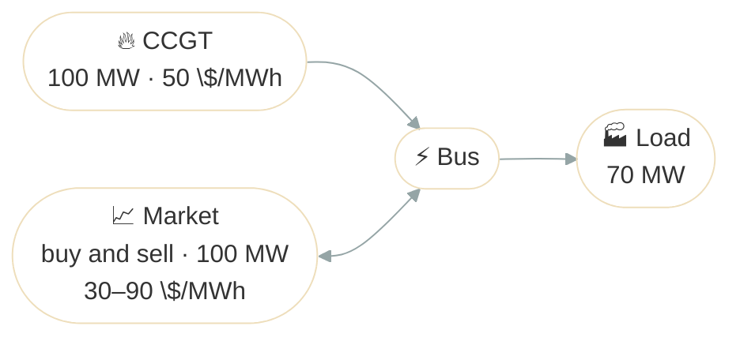

# Make or Buy

## Problem Description

A site with a 100 MW CCGT at 50 $/MWh serves a constant 70 MW load over a day, and trades on a market whose price moves between 30 and 90 $/MWh. It can buy or sell up to 100 MW per step. The question is when to produce and when to buy, and whether to run the CCGT beyond the load to sell the rest.



**Source**: [`examples/make_or_buy.py`](https://github.com/ramirocrc/odys/blob/main/examples/make_or_buy.py). The script wraps the steps below in `run_make_or_buy()`, which returns the results.

## Walkthrough

### 1. Define the assets and the market

A [generator](../user_guide/assets/generator.md), a [fixed load](../user_guide/assets/fixed_load.md), and a [market](../user_guide/markets/energy_market.md). A market buys and sells unless you [restrict its direction](../user_guide/markets/energy_market.md#trade-direction), and it isn't an asset, so it stays out of the portfolio:

```python
from datetime import timedelta

from odys import (
    AssetPortfolio,
    EnergyMarket,
    EnergySystem,
    FixedLoad,
    Generator,
    LoadProfile,
    PriceProfile,
    Scenario,
)

ccgt = Generator(
    name="ccgt",
    nominal_power=100,
    variable_cost=50,
)
load = FixedLoad(
    name="load",
)

market = EnergyMarket(
    name="market",
    max_trading_volume_per_step=100,
)

portfolio = AssetPortfolio([ccgt, load])
```

### 2. Describe the day

The load is 70 MW throughout, and the market's [price profile](../user_guide/markets/energy_market.md#profiles) is low around midday and high in the morning and evening:

```python
scenario = Scenario(
    profiles=(
        LoadProfile(load=load, values=24 * [70]),
        PriceProfile(
            market=market,
            values=[80, 75, 70, 65, 60, 55, 52, 45, 40, 35, 30, 35, 40, 45, 52, 55, 60, 70, 80, 90, 85, 80, 75, 70],
        ),
    ),
)
```

### 3. Solve

The market goes in `markets`, next to the portfolio:

```python
energy_system = EnergySystem(
    portfolio=portfolio,
    markets=market,
    timestep=timedelta(hours=1),
    number_of_steps=24,
    scenarios=scenario,
)

result = energy_system.optimize()
```

## Results

The top chart shows the CCGT's output and the market trades, with purchases as positive bars and sales as negative ones. The bottom chart shows the market price against the CCGT's 50 $/MWh:

<iframe src="../assets/plots/make_or_buy.html" style="width:100%; height:700px; border:none;" loading="lazy"></iframe>

At each step, the optimizer compares the price with the CCGT's cost:

- **Steps 0 to 6 and 14 to 23** (52 to 90 $/MWh): the market pays more than the CCGT costs, so the CCGT runs at its full 100 MW. It serves the 70 MW load and sells the other 30 MW.
- **Steps 7 to 13** (30 to 45 $/MWh): buying is cheaper than producing, so the CCGT is off and the site buys the whole 70 MW.

Over the day, the CCGT produces 1,700 MWh at a cost of 85,000. The site sells 510 MWh for 35,220 and buys 490 MWh for 18,900, so `result.objective_value` is −68,680. The site sells only 30 MW because the CCGT is capped at 100 MW; the market's 100 MW volume limit never binds. Selling earns 9,720 of that: without it, the site would only choose between producing and buying, at −78,400. The trades are in `result.markets`, where `net_volume` is negative when the site buys; see [Results](../user_guide/markets/energy_market.md#results) on the EnergyMarket page.

## Discussion

A market sets a price on every MWh at every step, so a unit's cost is weighed against that price rather than against the load: the CCGT runs flat out whenever it earns more than it costs, whatever the site needs. Each step is still decided on its own. The [CVaR Market Risk](cvar_market_risk.md) example plans against several possible price futures, and weighs how bad the worst ones could be.
