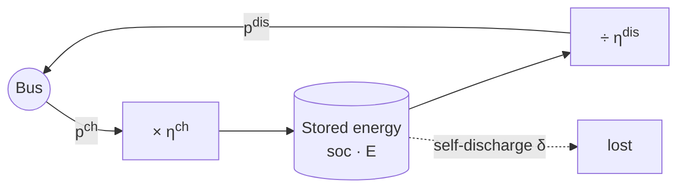

# Batteries

How do I move energy in time? With a battery. You charge it when power is cheap or plentiful, and discharge it when it's expensive or scarce. Every MWh that goes in comes out a little smaller, and the battery slowly leaks while it waits, so moving energy has a price.

This page covers the battery model that stationary storage and electric vehicles share. It's written once, for every battery $k \in \mathcal{K} = \mathcal{B} \cup \mathcal{E}$. Electric vehicles add their trips on top of it; see [Electric vehicles and chargers](electric_vehicles.md).

## Sets and indices

Batteries live in $\mathcal{K} = \mathcal{B} \cup \mathcal{E}$, with index $k$: the stationary storages $\mathcal{B}$ and the electric vehicles $\mathcal{E}$. odys builds the same constraints for both, with names that start with `stationary_storage_` or `ev_`.

## Variables

For each battery, scenario and step, odys decides:

- $p^{ch}_{k,s,t} \ge 0$: the charging power, taken from the bus, in MW.
- $p^{dis}_{k,s,t} \ge 0$: the discharging power, fed into the bus, in MW.
- $\mathrm{soc}_{k,s,t} \ge 0$: the state of charge at the end of step $t$, as a **fraction of the capacity** (0 is empty, 1 is full).
- $z_{k,s,t} \in \{0, 1\}$: the mode, 1 when the battery may charge and 0 when it may discharge.
- $p^{net}_{k,s,t}$: the net power, charging minus discharging, in MW. It can take either sign.

Here's where the energy goes, and where it's lost:

Charging $p^{ch}$ MW for a step stores $\eta^{ch}_k\, p^{ch}\, \Delta t$ MWh. Delivering $p^{dis}$ MW for a step takes $p^{dis}\, \Delta t / \eta^{dis}_k$ MWh out of the cells.

## Constraints

### B-1 · Charging stays within the rating, in charging mode {#b-1}

A battery charges at most at its rated charging power, and only in charging mode.

$$
p^{ch}_{k,s,t} \le z_{k,s,t}\, \overline{P}^{ch}_k \qquad \forall k \in \mathcal{K},\ s \in \mathcal{S},\ t \in \mathcal{T}
$$

Read aloud: in charging mode, charge up to the rating; otherwise, don't charge at all.

**Why it looks like this.** It's half of the mode switch in [B-2](#b-2), and it also caps charging at the rating $\overline{P}^{ch}_k$.

`Added: always · Binds: when the battery charges at full power, or is in discharging mode · Names: stationary_storage_max_charge_constraint, ev_max_charge_constraint`

### B-2 · Discharging stays within the rating, outside charging mode {#b-2}

A battery discharges at most at its rated discharging power, and only when it isn't in charging mode.

In words, the two together say a battery doesn't charge and discharge at the same step:

$$
p^{ch}_{k,s,t} = 0 \ \text{ or } \ p^{dis}_{k,s,t} = 0 \qquad \forall k \in \mathcal{K},\ s \in \mathcal{S},\ t \in \mathcal{T}
$$

odys writes it with the mode $z_{k,s,t}$ and the ratings as big-M:

$$
p^{dis}_{k,s,t} \le \left(1 - z_{k,s,t}\right) \overline{P}^{dis}_k \qquad \forall k \in \mathcal{K},\ s \in \mathcal{S},\ t \in \mathcal{T}
$$

Read aloud: in discharging mode, discharge up to the rating; in charging mode, don't discharge.

**Why it looks like this.** Unlike the market's trade mode ([M-2](markets.md#m-2)), this binary changes the plan. Every MWh that goes in and out again loses energy to the efficiencies. Charging and discharging at once would just burn energy, and that sometimes pays: when prices are negative, the optimizer would happily waste power to get paid for taking it. The mode stops that. The code writes the inequality as $p^{dis}_{k,s,t} + z_{k,s,t}\,\overline{P}^{dis}_k \le \overline{P}^{dis}_k$, the same thing rearranged.

**Good to know.**

- With $\overline{P}^{dis}_k = 0$ the battery can only charge. For an electric vehicle, that means no vehicle-to-grid.
- When the battery is idle, either mode fits, so the reported `charge_mode` can be 0 or 1 at a step without any power.
- It costs one binary per battery, scenario and step.

`Added: always · Binds: when the battery discharges at full power, or is in charging mode · Names: stationary_storage_max_discharge_constraint, ev_max_discharge_constraint`

### B-3 · Charge carries over from step to step {#b-3}

The charge at the end of a step is the charge from the step before, less what leaked away, plus what came in, minus what went out.

$$
\mathrm{soc}_{k,s,t} = \mathrm{soc}_{k,s,t-1} \left(1 - \delta_k\, \Delta t\right)
+ \frac{\eta^{ch}_k\, p^{ch}_{k,s,t}\, \Delta t}{E_k}
- \frac{p^{dis}_{k,s,t}\, \Delta t}{\eta^{dis}_k\, E_k}
\qquad \forall k \in \mathcal{K},\ s \in \mathcal{S},\ t \in \mathcal{T}
$$

with $\mathrm{soc}_{k,s,-1} = \mathrm{soc}^{init}_k$, the initial state of charge.

Read aloud: what's left from the last step, minus the leak, plus the energy you stored, minus the energy you took out, all as a share of the capacity.

**Why it looks like this.** This is what makes a battery a battery: it links one step to the next, so energy stored now can be used later. Each term is energy over capacity, so the state of charge stays a fraction. The efficiencies sit on opposite sides: charging stores less than you draw ($\times \eta^{ch}_k$), and discharging takes more than you deliver ($\div \eta^{dis}_k$). A round trip keeps $\eta^{ch}_k \eta^{dis}_k$ of the energy.

**Good to know.**

- odys builds the first step separately, from the initial state, and the other steps from the step before. They're the same equation, with two names.
- The initial state of charge is required for every battery, and it's the same in every scenario.
- Self-discharge is applied as $(1 - \delta_k\, \Delta t)$, with $\delta_k$ per hour. For long steps that factor can drop below 0 ([#158](https://github.com/ramirocrc/odys/issues/158)).
- Electric vehicles lose the energy of their trips here too: [Electric vehicles and chargers](electric_vehicles.md) adds that term to this equation.

`Added: always · Binds: always · Names: stationary_storage_soc_start_constraint, stationary_storage_soc_dynamics_constraint, ev_soc_start_constraint, ev_soc_dynamics_constraint`

### B-4 · The last step hits the final charge {#b-4}

If you set a final state, the battery ends the run at exactly that charge.

$$
\mathrm{soc}_{k,s,T-1} = \mathrm{soc}^{final}_k \qquad \forall k \in \mathcal{K}^{final},\ s \in \mathcal{S}
$$

where $\mathcal{K}^{final}$ holds the batteries with a `StorageFinalState` or an `ElectricVehicleFinalState`.

Read aloud: whatever happens along the way, the battery finishes at the charge you asked for.

**Why it looks like this.** Energy left in a battery at the end of the run has no value in the objective. Without a final state, the optimizer sells or uses everything it can by the last step, as if there were no tomorrow. A final state hands the next run a known starting point, and keeps the plan from emptying the battery just because the horizon ends.

**Good to know.**

- The final charge is the same in every scenario.
- It's an exact value, not a bound: a battery that would rather end fuller has to discharge to hit it. "At least" is proposed in [#163](https://github.com/ramirocrc/odys/issues/163).

`Added: only with a final state · Binds: always, when added · Names: stationary_storage_soc_end_constraint, ev_soc_end_constraint`

### B-5 · Charge stays between its limits {#b-5}

The state of charge never goes below its minimum or above its maximum.

$$
\underline{\mathrm{soc}}_k \le \mathrm{soc}_{k,s,t} \le \overline{\mathrm{soc}}_k \qquad \forall k \in \mathcal{K},\ s \in \mathcal{S},\ t \in \mathcal{T}
$$

Read aloud: keep the battery out of the very bottom and the very top of its range.

**Why it looks like this.** Running a battery fully empty or full wears it out faster, so operators keep a margin at both ends. For an electric vehicle, the minimum is also a reserve for an unexpected drive.

**Good to know.**

- The defaults are 0 and 1. odys checks that $\underline{\mathrm{soc}}_k < \overline{\mathrm{soc}}_k$, and that the initial and final states of charge lie between them.

`Added: always · Binds: when the battery is at a limit · Names: stationary_storage_soc_min_constraint, stationary_storage_soc_max_constraint, ev_soc_min_constraint, ev_soc_max_constraint`

### B-6 · A battery can't be more than full {#b-6}

The state of charge is at most 1.

$$
\mathrm{soc}_{k,s,t} \le 1 \qquad \forall k \in \mathcal{K},\ s \in \mathcal{S},\ t \in \mathcal{T}
$$

Read aloud: a battery holds at most its capacity.

**Why it looks like this.** It states the physical limit on its own, apart from the operating limits in B-5.

**Good to know.**

- B-5 already implies it, because $\overline{\mathrm{soc}}_k \le 1$. So B-6 never binds on its own ([#143](https://github.com/ramirocrc/odys/issues/143)).

`Added: always · Binds: never on its own (B-5 implies it) · Names: stationary_storage_capacity_constraint, ev_capacity_constraint`

### B-7 · Net power is charging minus discharging {#b-7}

The net power is what the battery takes in, minus what it gives back.

$$
p^{net}_{k,s,t} = p^{ch}_{k,s,t} - p^{dis}_{k,s,t} \qquad \forall k \in \mathcal{K},\ s \in \mathcal{S},\ t \in \mathcal{T}
$$

Read aloud: positive while the battery charges, negative while it discharges.

**Why it looks like this.** It's the one series that tells you what the battery did at a step, from its own point of view. It's the opposite sign of its injection into the bus (see the [sign convention](notation.md#sign-convention)).

**Good to know.**

- Nothing else in the model uses $p^{net}$; it only exists for the results. Computing it from the results instead is proposed in [#157](https://github.com/ramirocrc/odys/issues/157).
- The docstring of `net_power` in the results says "discharging − charging", which is the wrong way round ([#164](https://github.com/ramirocrc/odys/issues/164)).

`Added: always · Binds: always · Names: stationary_storage_net_power_constraint, ev_net_power_constraint`

## Power balance contribution

Discharging feeds the bus and charging takes from it, so each battery adds

$$
p^{dis}_{k,s,t} - p^{ch}_{k,s,t}
$$

to the [power balance](power_balance.md#pb-1) at every step. An electric vehicle can only do so while it's connected to a charger.

Before solving, odys counts each battery as able to deliver at most one full battery of energy over the horizon, whatever its initial charge. Like the other checks, that's optimistic (see [PB-1](power_balance.md#pb-1)).

## Objective contribution

Each battery adds its wear, with a minus sign, to the profit $\Pi_s$ of every scenario (see [Objective](objective.md#profit-per-scenario)):

$$
-\sum_{k \in \mathcal{K}} \sum_{t \in \mathcal{T}} c^{deg}_k \left(p^{ch}_{k,s,t} + p^{dis}_{k,s,t}\right) \Delta t
$$

Read aloud: every MWh that goes in or out costs a little wear.

- Both directions count, so a full cycle pays twice. The field is described as "per MWh cycled", which can also be read as per full cycle ([#159](https://github.com/ramirocrc/odys/issues/159)).
- The energy is measured at the bus, before the charging losses and after the discharging ones.
- With $c^{deg}_k = 0$, cycling is free, and the battery trades on any price difference that beats its losses.

## Where to find each symbol in odys

| Symbol | Attribute | Type | Unit |
| ------ | --------- | ---- | ---- |
| $\mathcal{B}$, $\mathcal{E}$ | `StationaryStorage`, `ElectricVehicle` | Parameter | – |
| $E_k$ | `Battery.capacity` | Parameter | MWh |
| $\overline{P}^{ch}_k$ | `Battery.max_charge_power` | Parameter | MW |
| $\overline{P}^{dis}_k$ | `Battery.max_discharge_power` | Parameter | MW |
| $\eta^{ch}_k$, $\eta^{dis}_k$ | `Battery.efficiency_charging`, `Battery.efficiency_discharging` | Parameter | – |
| $\delta_k$ | `Battery.self_discharge_rate` | Parameter | per hour |
| $\underline{\mathrm{soc}}_k$, $\overline{\mathrm{soc}}_k$ | `Battery.soc_min`, `Battery.soc_max` | Parameter | fraction of capacity |
| $\mathrm{soc}^{init}_k$ | `StorageInitialState.soc`, `ElectricVehicleInitialState.soc` | Parameter | fraction of capacity |
| $\mathrm{soc}^{final}_k$ | `StorageFinalState.soc`, `ElectricVehicleFinalState.soc` | Parameter | fraction of capacity |
| $c^{deg}_k$ | `Battery.degradation_cost` | Parameter | currency per MWh |
| $p^{ch}_{k,s,t}$ | `stationary_storage_power_in`, `ev_power_in` | Variable | MW |
| $p^{dis}_{k,s,t}$ | `stationary_storage_power_out`, `ev_power_out` | Variable | MW |
| $p^{net}_{k,s,t}$ | `stationary_storage_net_power`, `ev_net_power` · `results.stationary_storages.net_power`, `results.electric_vehicles.net_power` | Variable · Result | MW |
| $\mathrm{soc}_{k,s,t}$ | `stationary_storage_soc`, `ev_soc` · `results.stationary_storages.soc`, `results.electric_vehicles.soc` | Variable · Result | fraction of capacity |
| $z_{k,s,t}$ | `stationary_storage_charge_mode`, `ev_charge_mode` · `results.stationary_storages.charge_mode`, `results.electric_vehicles.charge_mode` | Variable · Result | – |

The results don't report $p^{ch}$ and $p^{dis}$ on their own, only their difference $p^{net}$ ([#157](https://github.com/ramirocrc/odys/issues/157)).

Some batteries drive away. See [Electric vehicles and chargers](electric_vehicles.md).

---

Implemented in [`odys.optimization.formulations.storage`](../developer/api/optimization/formulations/storage.md), used by [`stationary_storage`](../developer/api/optimization/formulations/stationary_storage.md) and [`electric_vehicle`](../developer/api/optimization/formulations/electric_vehicle.md).
