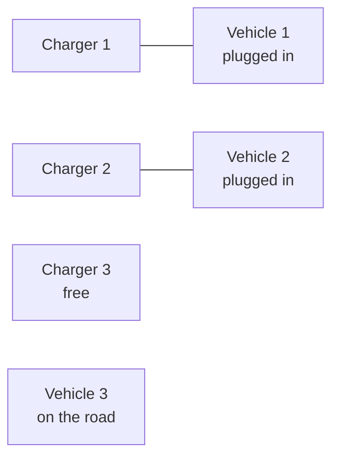

# Electric vehicles and chargers

When it's parked and plugged in, an electric vehicle behaves like a battery: it can charge, and some vehicles can also feed power back to the grid (vehicle-to-grid, or V2G). So odys models an electric vehicle as a [battery](batteries.md), with a few extra constraints for the times it's away: it can't charge on the road, its trips use energy, and it has to leave with enough charge to make the trip.

This page covers those additions, and the chargers a vehicle needs to reach the bus. Chargers and vehicles come together: odys asks for at least one charger as soon as there's a vehicle, and the other way round.

## Sets and indices

| Set | What it holds | Index |
| --- | ------------- | ----- |
| $\mathcal{E}$ | Electric vehicles | $e$ |
| $\mathcal{C}$ | Chargers | $c$ |
| $\mathcal{R}_e$ | The trips of vehicle $e$ | $r$ |
| $\mathcal{T}_r = \{t^{dep}_r, \dots, t^{ret}_r - 1\}$ | The steps vehicle $e$ is on the road during trip $r$ | $t$ |
| $\mathcal{T}^{drive}_e = \bigcup_{r \in \mathcal{R}_e} \mathcal{T}_r$ | Every step vehicle $e$ is on the road | $t$ |

A trip leaves at the start of step $t^{dep}_r$ and is back at the start of step $t^{ret}_r$, so it drives during the steps from $t^{dep}_r$ to $t^{ret}_r - 1$. odys turns the trip's `start_time` and `end_time` into these steps. It checks that both are whole numbers of steps, that the trip ends within the horizon, and that a vehicle's trips don't overlap.

## Variables

A vehicle has the battery variables $p^{ch}_{e,s,t}$, $p^{dis}_{e,s,t}$, $\mathrm{soc}_{e,s,t}$, $z_{e,s,t}$ and $p^{net}_{e,s,t}$ (see [Batteries](batteries.md#variables)). The chargers add one more decision:

- $a_{c,e,s,t} \in \{0, 1\}$: 1 when vehicle $e$ is connected to charger $c$ at step $t$.

## Electric vehicles

For example, a trip that departs at step 3 and is back at step 6 drives during $\mathcal{T}_r = \{3, 4, 5\}$. Its minimum charge is checked at the end of step 2, and the vehicle is free to plug in again from step 6.

### EV-1 · Trips drain the battery {#ev-1}

While a vehicle drives, its trip's energy leaves the battery, spread evenly over the steps of the trip.

The state of charge follows [B-3](batteries.md#b-3), with one more term for the trip:

$$
\mathrm{soc}_{e,s,t} = \mathrm{soc}_{e,s,t-1} \left(1 - \delta_e\, \Delta t\right)
+ \frac{\eta^{ch}_e\, p^{ch}_{e,s,t}\, \Delta t}{E_e}
- \frac{p^{dis}_{e,s,t}\, \Delta t}{\eta^{dis}_e\, E_e}
- \frac{E^{trip}_{e,t}}{E_e}
\qquad \forall e \in \mathcal{E},\ s \in \mathcal{S},\ t \in \mathcal{T}
$$

with $\mathrm{soc}_{e,s,-1} = \mathrm{soc}^{init}_e$, and the trip energy of each step

$$
E^{trip}_{e,t} =
\begin{cases}
E^{trip}_r / |\mathcal{T}_r| & \text{if } t \in \mathcal{T}_r \text{ for a trip } r \in \mathcal{R}_e \\
0 & \text{otherwise}
\end{cases}
$$

Read aloud: on the road, the battery loses an equal share of the trip's energy at every step.

**Why it looks like this.** Driving uses energy straight from the battery: it never passes through the bus, so it can't be in the [power balance](power_balance.md#pb-1). It goes into the state of charge instead. odys only knows how much energy a trip takes, not when along the way, so it spreads it evenly over the trip's steps.

**Good to know.**

- $E^{trip}_r$ is the energy the battery provides, after every loss in the drivetrain.
- A trip's energy has no price of its own. It costs whatever it takes to charge it back (see [Objective](objective.md#profit-per-scenario)).
- [B-5](batteries.md#b-5) still holds on the road: the charge can't drop below $\underline{\mathrm{soc}}_e$. A trip that doesn't fit in the charge the vehicle can have when it leaves makes the whole problem infeasible. odys only checks this beforehand for a trip that departs at $t = 0$.
- These are the battery's own constraints, so the names are the ones of B-3.
- `Trip.energy_consumption` doesn't use strict validation, unlike the other fields ([#161](https://github.com/ramirocrc/odys/issues/161)).

`Added: always · Binds: always · Names: ev_soc_start_constraint, ev_soc_dynamics_constraint`

### EV-2 · No charging on the road {#ev-2}

While a vehicle drives, it neither charges nor discharges.

$$
p^{ch}_{e,s,t} + p^{dis}_{e,s,t} = 0 \qquad \forall e \in \mathcal{E},\ s \in \mathcal{S},\ t \in \mathcal{T}^{drive}_e
$$

Read aloud: a car on the road isn't plugged in.

**Why it looks like this.** It's the obvious rule, said directly. The code writes it for every step, with a driving indicator that is 1 on the road and 0 otherwise:

$$
p^{ch}_{e,s,t} + p^{dis}_{e,s,t} \le \left(\overline{P}^{ch}_e + \overline{P}^{dis}_e\right) \left(1 - \mathbb{1}[t \in \mathcal{T}^{drive}_e]\right)
$$

**Good to know.**

- [CH-3](#ch-3) and [CH-4](#ch-4) already imply it: a driving vehicle has no charger, and without a charger it gets no power. So EV-2 never binds on its own ([#145](https://github.com/ramirocrc/odys/issues/145)).

`Added: always · Binds: never on its own (CH-3 and CH-4 imply it) · Name: ev_driving_constraint`

### EV-3 · Enough charge before every trip {#ev-3}

At the end of the step before a trip departs, the battery holds at least the trip's minimum charge.

$$
\mathrm{soc}_{e,s,t^{dep}_r - 1} \ge \underline{\mathrm{soc}}^{dep}_r \qquad \forall e \in \mathcal{E},\ r \in \mathcal{R}_e \text{ with } t^{dep}_r \ge 1,\ s \in \mathcal{S}
$$

Read aloud: when the driver picks up the car, it's charged enough for the trip.

**Why it looks like this.** States describe the end of a step, and the trip starts at the beginning of step $t^{dep}_r$. So the last moment the charge can be checked is the end of the step before. The minimum is on the charge *before* the trip uses any of its energy. It's a promise to the driver, often more than the trip strictly needs.

**Good to know.**

- The default $\underline{\mathrm{soc}}^{dep}_r$ is 0, so without it, only the battery's own minimum applies.
- A trip that departs at $t = 0$ has no step before it in the horizon, so there's no row for it. odys checks instead that the initial state of charge meets the trip's minimum, and that it holds the trip's energy above $\underline{\mathrm{soc}}_e$.
- The code writes a row for every step, with a minimum of 0 at the steps that aren't right before a departure. Those rows never bind ([#154](https://github.com/ramirocrc/odys/issues/154)).

`Added: always · Binds: at the step before a departure, when charging is short · Name: ev_min_soc_departure_constraint`

## Chargers

A vehicle reaches the bus only through a charger. At each step, odys decides which vehicle uses which charger:

Each line is one $a_{c,e,s,t} = 1$. A charger has at most one line, and so has a vehicle; a vehicle on the road has none.

### CH-1 · A charger serves one vehicle at a time {#ch-1}

At every step, each charger is connected to at most one vehicle.

$$
\sum_{e \in \mathcal{E}} a_{c,e,s,t} \le 1 \qquad \forall c \in \mathcal{C},\ s \in \mathcal{S},\ t \in \mathcal{T}
$$

Read aloud: one plug, one car.

**Why it looks like this.** A charger has one connector. Without this rule, one charger's rating could be shared by the whole fleet.

`Added: always · Binds: when more vehicles want to charge than there are chargers · Name: charger_one_ev_per_charger_constraint`

### CH-2 · A vehicle uses one charger at a time {#ch-2}

At every step, each vehicle is connected to at most one charger.

$$
\sum_{c \in \mathcal{C}} a_{c,e,s,t} \le 1 \qquad \forall e \in \mathcal{E},\ s \in \mathcal{S},\ t \in \mathcal{T}
$$

Read aloud: one car, one plug.

**Why it looks like this.** A vehicle has one inlet. Without this rule, it could plug into two chargers at once and add up their ratings.

**Good to know.**

- A vehicle can move to another charger from one step to the next, at no cost.

`Added: always · Binds: when a vehicle could use more than one charger's rating · Name: charger_one_charger_per_ev_constraint`

### CH-3 · No plugging in while driving {#ch-3}

A vehicle on the road isn't connected to any charger.

$$
a_{c,e,s,t} = 0 \qquad \forall c \in \mathcal{C},\ e \in \mathcal{E},\ s \in \mathcal{S},\ t \in \mathcal{T}^{drive}_e
$$

Read aloud: the charger stays free while the car is away.

**Why it looks like this.** A driving vehicle is somewhere else. Keeping it off the chargers both stops it from charging and frees the charger for another vehicle. The code writes it for every step, as $a_{c,e,s,t} \le 1 - \mathbb{1}[t \in \mathcal{T}^{drive}_e]$.

`Added: always · Binds: always, on the road · Name: charger_no_assignment_while_driving_constraint`

### CH-4 · Power flows only through a charger, up to its rating {#ch-4}

A vehicle charges or discharges at most at the rating of the charger it's connected to, and not at all without one.

$$
p^{ch}_{e,s,t} + p^{dis}_{e,s,t} \le \sum_{c \in \mathcal{C}} a_{c,e,s,t}\, \overline{P}_c \qquad \forall e \in \mathcal{E},\ s \in \mathcal{S},\ t \in \mathcal{T}
$$

Read aloud: no plug, no power; with a plug, at most what the charger can deliver.

**Why it looks like this.** The charger is the bottleneck between the bus and the vehicle. By CH-2, at most one term of the sum is non-zero, so the right side is the rating of the vehicle's charger, or 0. Charging and discharging share the rating, and [B-2](batteries.md#b-2) keeps one of them at 0 anyway. The vehicle's own ratings $\overline{P}^{ch}_e$ and $\overline{P}^{dis}_e$ still apply, so the tighter of the two limits wins.

**Good to know.**

- Any charger lets a vehicle discharge when its battery allows it ($\overline{P}^{dis}_e > 0$). There's no setting for one-way chargers ([#156](https://github.com/ramirocrc/odys/issues/156)).
- `Charger.efficiency` isn't used: charging through a charger loses nothing beyond the battery's own efficiencies ([#155](https://github.com/ramirocrc/odys/issues/155)).
- Connecting costs nothing, so a vehicle can be connected without any power flowing. Chargers with the same rating are interchangeable, so many assignments make the same plan ([#160](https://github.com/ramirocrc/odys/issues/160)).
- `results.chargers.power` is the charging power through each charger, $\sum_e a_{c,e,s,t}\, p^{ch}_{e,s,t}$. It leaves out discharging ([#142](https://github.com/ramirocrc/odys/issues/142)).
- The assignment costs one binary per charger, vehicle, scenario and step: $|\mathcal{C}| \cdot |\mathcal{E}| \cdot |\mathcal{S}| \cdot |\mathcal{T}|$ in total. It's often the largest block of binaries in a fleet model.

`Added: always · Binds: when a vehicle charges at its charger's rating, or isn't connected · Name: charger_power_limit_constraint`

## Power balance contribution

A vehicle adds its battery's $p^{dis}_{e,s,t} - p^{ch}_{e,s,t}$ to the [power balance](power_balance.md#pb-1), like any battery (see [Batteries](batteries.md#power-balance-contribution)). Chargers add nothing of their own: they only decide when and how fast that power can flow.

## Objective contribution

A vehicle adds its battery's wear, $-\sum_t c^{deg}_e \left(p^{ch}_{e,s,t} + p^{dis}_{e,s,t}\right) \Delta t$, like any battery (see [Batteries](batteries.md#objective-contribution)). Trips and chargers add nothing: driving and connecting are free, and the trip's energy costs whatever it takes to charge it back.

## Where to find each symbol in odys

| Symbol | Attribute | Type | Unit |
| ------ | --------- | ---- | ---- |
| $\mathcal{E}$ | `ElectricVehicle` | Parameter | – |
| $\mathcal{C}$ | `Charger` | Parameter | – |
| $\mathcal{R}_e$ | `ElectricVehicle.trips` | Parameter | – |
| $t^{dep}_r$ | `Trip.start_time`, in steps | Parameter | steps |
| $t^{ret}_r$ | `Trip.end_time`, in steps | Parameter | steps |
| $E^{trip}_r$ | `Trip.energy_consumption` | Parameter | MWh |
| $\underline{\mathrm{soc}}^{dep}_r$ | `Trip.min_soc_at_departure` | Parameter | fraction of capacity |
| $\overline{P}_c$ | `Charger.max_power` | Parameter | MW |
| $a_{c,e,s,t}$ | `charger_ev_assignment` · `results.chargers.assignment` | Variable · Result | – |
| $\sum_e a_{c,e,s,t}\, p^{ch}_{e,s,t}$ | `results.chargers.power` | Result | MW |

The battery symbols ($E_e$, $\overline{P}^{ch}_e$, $\mathrm{soc}_{e,s,t}$, …) are on the [Batteries](batteries.md#where-to-find-each-symbol-in-odys) page. Trip times count from the start of the run, not from a date ([#135](https://github.com/ramirocrc/odys/issues/135)).

Last piece: demand that can bend. See [Flexible loads](flexible_loads.md).

---

Implemented in [`odys.optimization.formulations.electric_vehicle`](../developer/api/optimization/formulations/electric_vehicle.md) and [`odys.optimization.formulations.charging`](../developer/api/optimization/formulations/charging.md).
