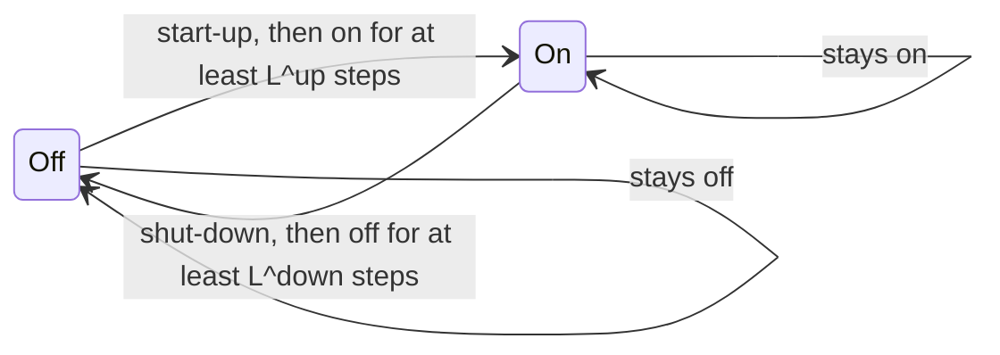

# Generators

How do I make my own power? With a generator: a gas turbine, an engine, a wind farm. Each one has a rating and maybe a minimum output. It costs fuel per MWh, and some units also cost money to start or stop. Big thermal units also take time to change their output, and once started or stopped, they have to stay that way for a while.

This page covers every `Generator`. Most of its rules are about the unit being **on or off**, so it starts with the decisions, then goes from the simplest limits to the ones that look across several steps.

## Sets and indices

Generators live in $\mathcal{G}$, with index $g$. For the windows of the minimum up and down times, $\tau$ counts the steps inside a sum.

## Variables

For each generator, scenario and step, odys decides:

- $p_{g,s,t} \ge 0$: the output, in MW.
- $u_{g,s,t} \in \{0, 1\}$: the status, 1 when the unit is on.
- $y^{start}_{g,s,t} \in \{0, 1\}$: 1 when the unit starts at step $t$.
- $y^{stop}_{g,s,t} \in \{0, 1\}$: 1 when the unit stops at step $t$.

Several rules look one step back. At $t = 0$, "the step before" is the initial condition: the output is $P^{init}_g$, and the unit was on if $P^{init}_g > 0$, written $u_{g,s,-1} = 1$. Without a `GeneratorInitialState`, the unit starts off ([Notation](notation.md#initial-condition-defaults)).

## Constraints

### G-1 · Output never exceeds the rating {#g-1}

A unit that's on produces at most its rating, and a unit that's off produces nothing.

$$
p_{g,s,t} \le u_{g,s,t}\, \overline{P}_g \qquad \forall g \in \mathcal{G},\ s \in \mathcal{S},\ t \in \mathcal{T}
$$

Read aloud: if the unit is off, the output is zero; if it's on, the output stays below the nameplate.

**Why it looks like this.** One inequality does two jobs. It caps the output at the rating $\overline{P}_g$, and it ties the output to the status: with $u_{g,s,t} = 0$, the right side is zero. Without it, a unit could produce while "off", and it would never pay its start-up cost.

`Added: always · Binds: when the unit runs at full output, or is off · Name: generator_max_power_constraint`

### G-2 · On means producing {#g-2}

A unit marked on produces at least a tiny amount.

$$
p_{g,s,t} \ge \varepsilon_g\, u_{g,s,t}, \qquad \varepsilon_g = 10^{-5}\, \overline{P}_g \qquad \forall g \in \mathcal{G},\ s \in \mathcal{S},\ t \in \mathcal{T}
$$

Read aloud: if the unit is on, its output is above zero.

**Why it looks like this.** G-1 already says "off means not producing". G-2 is the other direction: "on means producing". So $u_{g,s,t} = 1$ in the results always comes with real output, and a unit can't sit "on" at 0 MW. The threshold $\varepsilon_g$ is a small share of the rating, fixed in the code. You can't set it.

**Good to know.**

- With a minimum output above $\varepsilon_g$, [G-3](#g-3) is the stronger rule, and G-2 never binds. Whether the threshold should stay fixed, become a setting, or apply only without a minimum output is open ([#154](https://github.com/ramirocrc/odys/issues/154)).

`Added: always · Binds: when the unit is on with no minimum output · Name: generator_status_constraint`

### G-3 · When on, output stays above the minimum {#g-3}

A unit that's on produces at least its minimum output.

$$
p_{g,s,t} \ge \underline{P}_g\, u_{g,s,t} \qquad \forall g \in \mathcal{G},\ s \in \mathcal{S},\ t \in \mathcal{T}
$$

Read aloud: when the unit runs, it runs at least at its minimum; when it's off, this says nothing.

**Why it looks like this.** Many units can't run stably below some load: a gas turbine or an engine has a technical minimum. Multiplying by the status makes the minimum apply only when the unit is on, so "off at 0 MW" stays possible. This is what makes generators a mixed-integer problem: the allowed output is $\{0\} \cup [\underline{P}_g, \overline{P}_g]$, which has a gap.

**Good to know.**

- The default minimum is 0, and then G-3 never binds.
- odys doesn't check that $\underline{P}_g \le \overline{P}_g$. With a minimum above the rating, G-1 and G-3 together keep the unit off for the whole run, with no error ([#147](https://github.com/ramirocrc/odys/issues/147)).

`Added: always · Binds: when the unit runs at its minimum · Name: generator_min_power_constraint`

### G-4 · Output fits the available capacity {#g-4}

In each scenario, the output stays below what the unit can deliver at that step.

$$
p_{g,s,t} \le A_{g,s,t} \qquad \forall g \in \mathcal{G},\ s \in \mathcal{S},\ t \in \mathcal{T}
$$

Read aloud: you can't produce more than the wind, the sun or an outage allows right now.

**Why it looks like this.** The rating is the most a unit can ever produce, but the wind isn't always blowing, and a unit may be partly out for maintenance. $A_{g,s,t}$ comes from the scenario's `AvailableCapacityProfile`, so it's one of the things that differ between futures. It's a plain cap, not multiplied by the status: G-1 already keeps an off unit at zero.

**Good to know.**

- Without a profile, $A_{g,s,t} = +\infty$: the rows are there, but they never bind ([#154](https://github.com/ramirocrc/odys/issues/154)).
- odys checks that each profile value is at most the rating.
- The name has no `generator_` prefix ([#161](https://github.com/ramirocrc/odys/issues/161)).

`Added: always · Binds: when the available capacity is below what the plan wants · Name: available_capacity_constraint`

### Start-ups and shut-downs

The next rules count when a unit switches. A start-up is a step where the unit is on and was off the step before; a shut-down is the other way round:

### G-5 · Start-ups are counted {#g-5}

A start-up happens exactly when the unit is on now and was off the step before.

In words: $y^{start}_{g,s,t} = u_{g,s,t}\,(1 - u_{g,s,t-1})$. odys writes it with three inequalities:

$$
y^{start}_{g,s,t} \ge u_{g,s,t} - u_{g,s,t-1}, \qquad
y^{start}_{g,s,t} \le u_{g,s,t}, \qquad
y^{start}_{g,s,t} + u_{g,s,t-1} \le 1 \qquad \forall g \in \mathcal{G},\ s \in \mathcal{S},\ t \in \mathcal{T}
$$

Read aloud: switching on counts as a start-up, and nothing else does.

**Why it looks like this.** The product of two binaries isn't linear, so it's split up. The first inequality forces a start-up when the unit switches on. The other two forbid one when the unit is off now, or was already on. Together they leave exactly one value for $y^{start}_{g,s,t}$, so it's right even when starting costs nothing.

**Good to know.**

- At $t = 0$, the step before is the initial condition $u_{g,s,-1}$. A unit that starts off and runs at the first step starts up at $t = 0$, and pays for it.
- The start-up cost $c^{start}_g$ is paid once per start-up, whatever the step length.

`Added: always · Binds: always (it fixes y^start) · Names: generator_startup_lower_bound_constraint, generator_startup_upper_bound_1_constraint, generator_startup_upper_bound_2_constraint`

### G-6 · Shut-downs are counted {#g-6}

A shut-down happens exactly when the unit was on the step before and is off now.

In words: $y^{stop}_{g,s,t} = u_{g,s,t-1}\,(1 - u_{g,s,t})$. odys writes it like G-5:

$$
y^{stop}_{g,s,t} \ge u_{g,s,t-1} - u_{g,s,t}, \qquad
y^{stop}_{g,s,t} \le u_{g,s,t-1}, \qquad
y^{stop}_{g,s,t} + u_{g,s,t} \le 1 \qquad \forall g \in \mathcal{G},\ s \in \mathcal{S},\ t \in \mathcal{T}
$$

Read aloud: switching off counts as a shut-down, and nothing else does.

**Why it looks like this.** The same reasoning as G-5, mirrored. Because $y^{start}_{g,s,t} \le u_{g,s,t}$ and $y^{stop}_{g,s,t} \le 1 - u_{g,s,t}$, a unit never starts and stops at the same step.

**Good to know.**

- The shut-down cost $c^{stop}_g$ is paid once per shut-down.

`Added: always · Binds: always (it fixes y^stop) · Names: generator_shutdown_lower_bound_constraint, generator_shutdown_upper_bound_1_constraint, generator_shutdown_upper_bound_2_constraint`

### G-7 · Output changes gradually {#g-7}

From one step to the next, the output rises at most by the ramp-up rate and falls at most by the ramp-down rate, times the step length.

$$
p_{g,s,t} - p_{g,s,t-1} \le \overline{R}^{up}_g\, \Delta t, \qquad
p_{g,s,t-1} - p_{g,s,t} \le \overline{R}^{down}_g\, \Delta t \qquad \forall g \in \mathcal{G},\ s \in \mathcal{S},\ t \in \mathcal{T}
$$

with $p_{g,s,-1} = P^{init}_g$.

Read aloud: a big unit can't jump from low to full output, or back, in one step.

**Why it looks like this.** Thermal units heat up and cool down slowly, and pushing them faster wears them out. The limit is on the change between two steps, so it needs the output of the step before, and at $t = 0$ that's the initial output. That's why odys asks for a `GeneratorInitialState` when a ramp is set.

**Good to know.**

- Without `ramp_up` or `ramp_down`, the limit is the rating $\overline{P}_g$, so it never binds: the output can't change by more than that anyway. The rows are added all the same ([#154](https://github.com/ramirocrc/odys/issues/154)).
- The rates are in MW per hour, so a generator ramps the same whatever the step length: with 15-minute steps, a `ramp_up` of 40 MW per hour allows 10 MW per step.
- The limit also applies when the unit starts or stops, from or to 0 MW. With a minimum output above one step's ramp-up limit, an off unit can never start, and with one above the ramp-down limit, a running unit can never stop ([#147](https://github.com/ramirocrc/odys/issues/147)).

`Added: always · Binds: only with ramp_up or ramp_down set · Names: generator_max_ramp_up_constraint, generator_max_ramp_down_constraint`

### G-8 · Once started, a unit stays on for a while {#g-8}

A unit that stops has been on for at least its minimum up time.

The rule: if the unit stops at step $t + 1$, it was on at each of the $L^{up}_g$ steps up to and including $t$. That's the same as "a unit that started stays on for $L^{up}_g$ steps", read from the other end.

odys writes it as one inequality per step, over a window of $L^{up}_g$ steps that ends at $t$:

$$
\sum_{\tau = \max(0,\ t - L^{up}_g + 1)}^{t} u_{g,s,\tau} + B^{up}_{g,t} \ \ge\ L^{up}_g\, y^{stop}_{g,s,t+1} \qquad \forall g \in \mathcal{G},\ s \in \mathcal{S},\ t \in \mathcal{T}
$$

Here $y^{stop}_{g,s,T} = 0$, so the last row never binds. $B^{up}_{g,t}$ is the number of steps of that window that lie before the horizon and that the unit already spent on:

$$
B^{up}_{g,t} =
\begin{cases}
\min\left(\max(0,\ L^{up}_g - 1 - t),\ N^{init}_g\right) & \text{if the unit starts on} \\
0 & \text{if it starts off}
\end{cases}
$$

At $t = 0$, a shut-down has no step before it in the horizon, so a separate row covers it. If the unit was on at the start, but for fewer than $L^{up}_g$ steps, it can't stop at the first step:

$$
y^{stop}_{g,s,0} = 0 \qquad \text{if } P^{init}_g > 0 \text{ and } N^{init}_g < L^{up}_g
$$

Read aloud: before you switch a unit off, look back over the last $L^{up}_g$ steps, counting the time it was on before the run. It must have been on for all of them.

**Why it looks like this.** Big units have a minimum run time: once started, they can't be stopped right away without damage. A window can't hold a stop if it isn't all "on", so every run lasts at least $L^{up}_g$ steps. The term $B^{up}_{g,t}$ carries the run that was already going when the horizon began: a unit that had been on for 1 step, with $L^{up}_g = 3$, must stay on for the first 2 steps.

**Good to know.**

- $L^{up}_g$ is `min_up_time` in steps. Without one, $L^{up}_g = 1$, and the rows never bind: a stop at $t + 1$ only needs the unit on at $t$, which G-6 already says. They're added all the same ([#154](https://github.com/ramirocrc/odys/issues/154)).
- odys builds one constraint per generator, so the name holds the generator's name.
- The time-zero row is added only when some generator is still within its minimum up time.
- On whole numbers, this is the textbook rule. A different way to write it (Rajan–Takriti) gives the solver a tighter relaxation and usually solves faster ([#141](https://github.com/ramirocrc/odys/issues/141)).

`Added: always (the time-zero row only when a unit starts within its minimum up time) · Binds: only with min_up_time set · Names: generator_min_uptime_{name}_constraint, generator_initial_min_uptime_constraint`

### G-9 · Once stopped, a unit stays off for a while {#g-9}

A unit that starts has been off for at least its minimum down time.

The rule mirrors G-8: if the unit starts at step $t + 1$, it was off at each of the $L^{down}_g$ steps up to and including $t$.

$$
\sum_{\tau = \max(0,\ t - L^{down}_g + 1)}^{t} \left(1 - u_{g,s,\tau}\right) + B^{down}_{g,t} \ \ge\ L^{down}_g\, y^{start}_{g,s,t+1} \qquad \forall g \in \mathcal{G},\ s \in \mathcal{S},\ t \in \mathcal{T}
$$

with $y^{start}_{g,s,T} = 0$, and $B^{down}_{g,t}$ defined like $B^{up}_{g,t}$, for a unit that starts off:

$$
B^{down}_{g,t} =
\begin{cases}
\min\left(\max(0,\ L^{down}_g - 1 - t),\ N^{init}_g\right) & \text{if the unit starts off} \\
0 & \text{if it starts on}
\end{cases}
$$

And at $t = 0$:

$$
y^{start}_{g,s,0} = 0 \qquad \text{if } P^{init}_g = 0 \text{ and } N^{init}_g < L^{down}_g
$$

Read aloud: before you switch a unit back on, it must have been off for the last $L^{down}_g$ steps, counting the time before the run.

**Why it looks like this.** Units also need time to cool down, or a stop would be followed by an immediate, expensive restart. It's the same window trick as G-8, on the steps off instead of on.

**Good to know.**

- $L^{down}_g$ is `min_down_time` in steps; without one it's 1, and the rows never bind ([#154](https://github.com/ramirocrc/odys/issues/154)).
- A unit with no initial state starts off, as if it had been off forever ($N^{init}_g = \infty$), so no minimum down time carries over.
- [#141](https://github.com/ramirocrc/odys/issues/141) applies here too.

`Added: always (the time-zero row only when a unit starts within its minimum down time) · Binds: only with min_down_time set · Names: generator_min_downtime_{name}_constraint, generator_initial_min_downtime_constraint`

### G-10 · The last step hits the final output {#g-10}

If you set a final state, the unit ends the run at exactly that output.

$$
p_{g,s,T-1} = P^{final}_g \qquad \forall g \in \mathcal{G}^{final},\ s \in \mathcal{S}
$$

where $\mathcal{G}^{final}$ holds the generators with a `GeneratorFinalState`.

Read aloud: whatever happens along the way, at the last step the unit produces exactly the output you asked for.

**Why it looks like this.** The run is often one piece of a longer schedule. Without a final state, the optimizer treats the end of the horizon as the end of the world, and may leave the unit wherever is cheapest for this run. Fixing the last output hands the next run a known starting point.

**Good to know.**

- The final output is the same in every scenario.
- It's an exact value, not a bound. Allowing "at least" or "at most" is proposed in [#163](https://github.com/ramirocrc/odys/issues/163).
- A final output of 0 means the unit ends the run off, because [G-2](#g-2) ties "on" to producing.
- odys checks that the final output is 0 or between the minimum and the rating, and that it fits each scenario's available capacity at the last step.

`Added: only with a GeneratorFinalState · Binds: always, when added · Name: generator_final_power_constraint`

## Power balance contribution

Each generator feeds its output into the bus, so it adds

$$
+\,p_{g,s,t}
$$

to the [power balance](power_balance.md#pb-1) at every step.

## Objective contribution

Each generator adds its cost, with a minus sign, to the profit $\Pi_s$ of every scenario (see [Objective](objective.md#profit-per-scenario)):

$$
-\sum_{g \in \mathcal{G}} \sum_{t \in \mathcal{T}} \left(c^{var}_g\, p_{g,s,t}\, \Delta t + c^{start}_g\, y^{start}_{g,s,t} + c^{stop}_g\, y^{stop}_{g,s,t}\right)
$$

Read aloud: the fuel for every MWh, plus a fixed amount for every start and every stop.

- The variable cost is per MWh, so it's multiplied by the step length. Start-up and shut-down costs are per event, so they aren't.
- All three costs are at least 0. A unit never earns money by running on its own; it earns through what the energy replaces or sells for.

## Where to find each symbol in odys

| Symbol | Attribute | Type | Unit |
| ------ | --------- | ---- | ---- |
| $\mathcal{G}$ | `Generator` | Parameter | – |
| $\overline{P}_g$ | `Generator.nominal_power` | Parameter | MW |
| $\underline{P}_g$ | `Generator.min_power` | Parameter | MW |
| $\varepsilon_g$ | $10^{-5}\, \overline{P}_g$, fixed in the code | Parameter | MW |
| $A_{g,s,t}$ | `AvailableCapacityProfile.values` | Parameter | MW |
| $\overline{R}^{up}_g$, $\overline{R}^{down}_g$ | `Generator.ramp_up`, `Generator.ramp_down` | Parameter | MW per hour |
| $L^{up}_g$, $L^{down}_g$ | `Generator.commitment.min_up_time`, `Generator.commitment.min_down_time`, in steps | Parameter | steps |
| $c^{var}_g$ | `Generator.variable_cost` | Parameter | currency per MWh |
| $c^{start}_g$, $c^{stop}_g$ | `Generator.commitment.startup_cost`, `Generator.commitment.shutdown_cost` | Parameter | currency per event |
| $P^{init}_g$ | `GeneratorInitialState.power` | Parameter | MW |
| $N^{init}_g$ | `GeneratorInitialState.time_in_state`, in steps | Parameter | steps |
| $P^{final}_g$ | `GeneratorFinalState.power` | Parameter | MW |
| $p_{g,s,t}$ | `generator_power` · `results.generators.power` | Variable · Result | MW |
| $u_{g,s,t}$ | `generator_status` · `results.generators.status` | Variable · Result | – |
| $y^{start}_{g,s,t}$ | `generator_startup` · `results.generators.startup` | Variable · Result | – |
| $y^{stop}_{g,s,t}$ | `generator_shutdown` · `results.generators.shutdown` | Variable · Result | – |

Power made now is used now, unless you can store it. See [Batteries](batteries.md).

---

Implemented in [`odys.optimization.formulations.generator`](../developer/api/optimization/formulations/generator.md).
