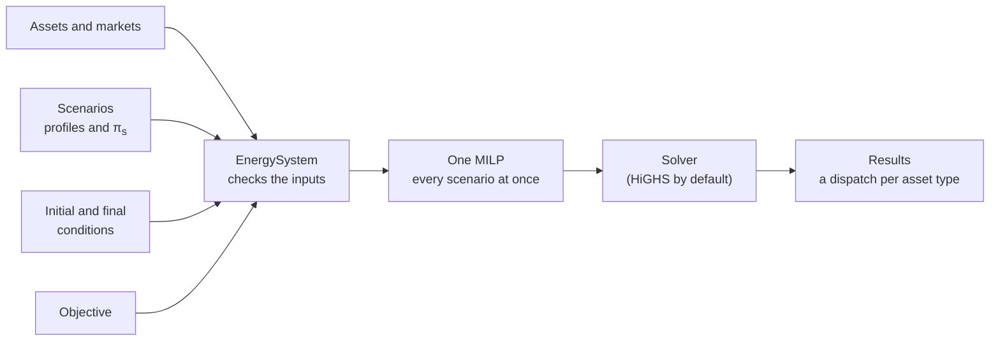

# Mathematical formulation

You own a few assets, you can trade on a few markets, and you don't know exactly what tomorrow brings. What should each asset do at every step? That's the question odys answers in every run, and this section shows exactly how it asks it.

Behind `EnergySystem.optimize()` sits one optimization problem: a set of decisions, a set of rules they have to follow, and a number to make as large as possible. These pages write that problem out, equation by equation, the way odys builds it. They're for anyone who wants to check what odys assumes before trusting a plan, or to understand why a result looks the way it does.

Start here for the big picture. Keep [Notation and conventions](notation.md) open as a reference, and read the other pages one model part at a time.

## The problem in one picture

You describe what you own, what you can trade on, and the futures you want to plan for. odys checks that the pieces fit together, builds one problem that covers every scenario at once, hands it to a solver, and reads back the plan: what each asset and market does at every step, in every scenario.

## How to read this section

The pages follow the questions you'd ask when building the model yourself. [Notation and conventions](notation.md) answers "how do I read the symbols?". [Scenarios](scenarios.md) asks what happens when the future isn't known, and [Non-anticipativity](non_anticipativity.md) which decisions can't wait for it. The [Objective](objective.md) says what counts as a good plan, and the [Power balance](power_balance.md) ties every asset together at every step. Then come the parts that fill the balance: [Markets](markets.md) to buy and sell, [Generators](generators.md) to make your own power, [Batteries](batteries.md) to move energy in time, [Electric vehicles and chargers](electric_vehicles.md) for batteries that drive away, and [Flexible loads](flexible_loads.md) for demand that can bend.

Each constraint has a short ID, like [G-7](generators.md#g-7), that you can link to and find again on this page.

## Problem class and size

odys builds a **mixed-integer linear program** (MILP) and **maximizes** it. Every rule is linear, and a few decisions are on/off choices: binaries. Binaries are what make a MILP hard, so their number is the first thing to look at when a model solves slowly:

| Binary | What it decides | Count |
| ------ | --------------- | ----- |
| $u_{g,s,t}$, $y^{start}_{g,s,t}$, $y^{stop}_{g,s,t}$ | A generator is on, starts, stops | $3 \cdot \lvert\mathcal{G}\rvert \cdot \lvert\mathcal{S}\rvert \cdot \lvert\mathcal{T}\rvert$ |
| $z_{k,s,t}$ | A battery may charge or discharge | $\lvert\mathcal{K}\rvert \cdot \lvert\mathcal{S}\rvert \cdot \lvert\mathcal{T}\rvert$ |
| $y^{trade}_{m,s,t}$ | A market buys or sells | $\lvert\mathcal{M}\rvert \cdot \lvert\mathcal{S}\rvert \cdot \lvert\mathcal{T}\rvert$ |
| $a_{c,e,s,t}$ | A vehicle is connected to a charger | $\lvert\mathcal{C}\rvert \cdot \lvert\mathcal{E}\rvert \cdot \lvert\mathcal{S}\rvert \cdot \lvert\mathcal{T}\rvert$ |

**Good to know.**

- Every count grows with the number of scenarios: each scenario gets its own copy of every decision.
- Only $u$ carries a real choice for a generator. Once the status is known, [G-5](generators.md#g-5) and [G-6](generators.md#g-6) fix the start-ups and shut-downs exactly.
- Every generator gets all three, even one with no `min_power`, no start or stop costs, no minimum times and no ramps, for which they decide nothing ([#174](https://github.com/ramirocrc/odys/issues/174)).
- The market trade mode removes only plans with the same payoff, because buying and selling use the same price ([#140](https://github.com/ramirocrc/odys/issues/140)).
- The charger assignment is often the largest block in a fleet model.
- The risk term adds no binaries: just one $\zeta$ and one $\xi_s$ per scenario ([CV-1](objective.md#cv-1)).

## What odys assumes (and what it doesn't)

Every model simplifies. These are the simplifications odys makes, each with the rule that makes it:

- **One bus.** Every asset and market connects to one point, with no network and no losses except a battery's efficiencies ([PB-1](power_balance.md#pb-1)).
- **The balance is exact.** There's no slack, no unserved energy and no curtailment, so a future that can't be balanced makes the whole problem infeasible ([PB-1](power_balance.md#pb-1), [#150](https://github.com/ramirocrc/odys/issues/150)).
- **Time comes in equal steps.** Power is constant within a step, and states like the state of charge describe the end of a step ([Notation](notation.md#time-and-boundary-conventions)).
- **You take prices as given.** Your trades don't move the price, buying and selling use the same price, and there are no fees. A stage-fixed trade is a price-independent bid, not a price-quantity curve ([NA-1](non_anticipativity.md#na-1)). A market is limited only by the cap you set and the direction it allows ([M-1](markets.md#m-1), [M-3](markets.md#m-3)). The cap is in MW today ([#146](https://github.com/ramirocrc/odys/issues/146)).
- **Costs are linear.** A generator has a cost per MWh and a cost per start-up and shut-down, but no cost for just being on, and a start-up costs the same however long the unit was off. Battery wear is a cost per MWh charged or discharged ([Objective](objective.md#profit-per-scenario), [#159](https://github.com/ramirocrc/odys/issues/159)).
- **Generator ramps apply at start-up and shut-down too**, as a rate in MW per hour times the step length ([G-7](generators.md#g-7), [#124](https://github.com/ramirocrc/odys/issues/124)).
- **Final conditions are exact**, and energy left in a battery at the end is worth nothing. Without a final state, the plan empties the battery whenever that pays ([B-4](batteries.md#b-4), [G-10](generators.md#g-10), [#163](https://github.com/ramirocrc/odys/issues/163)).
- **Chargers switch freely.** A vehicle can change chargers every step, at no cost ([CH-2](electric_vehicles.md#ch-2), [#160](https://github.com/ramirocrc/odys/issues/160)). `Charger.efficiency` isn't used ([CH-4](electric_vehicles.md#ch-4), [#155](https://github.com/ramirocrc/odys/issues/155)).
- **A flexible load doesn't shift energy.** Energy not used now isn't used later ([FL-1](flexible_loads.md#fl-1), [#162](https://github.com/ramirocrc/odys/issues/162)).
- **Each scenario sees its whole future.** Only trades on stage-fixed markets are decided before the future is known; generator commitment adapts to each scenario ([NA-1](non_anticipativity.md#na-1), [#153](https://github.com/ramirocrc/odys/issues/153)).
- **Without a stage-fixed market or a risk term, scenarios are independent.** Solving them together gives the same plan as solving each one on its own ([Scenarios](scenarios.md#when-scenarios-are-solved-on-their-own)).
- **No prices from the model.** odys reports no duals or marginal prices. In a MILP they only exist for the linear problem with the binaries fixed.

## Checked before solving

Some properties hold not because a constraint enforces them, but because `EnergySystem` refuses inputs that would break them. They're listed here so you don't look for a constraint that isn't there. When each check runs, and which error it raises, is in the User Guide's [Validation and errors](../user_guide/solving/validation.md):

- **Probabilities add up to 1**, and scenario names are unique (`ScenarioSet`).
- **Profiles fit the run.** Every profile has one value per step, references an asset or market of the system, and each market has a price in every scenario (`EnergySystem`).
- **Available capacity never exceeds the rating** (`AvailableCapacityProfile`).
- **A flexible load never goes negative.** Its lower bound is at least 0 and at most its upper bound, and both stay between `min_load` and `max_load` when they're set (`FlexibleLoadProfile`).
- **Durations are whole steps.** Minimum up and down times, a generator's time in its initial state, and trip departures and returns ([Notation](notation.md#time-and-boundary-conventions)). Trips end within the horizon (`ElectricVehicle`).
- **Trips don't overlap** (`ElectricVehicle`).
- **A trip that departs at the start fits in the initial charge**, both its minimum charge and its energy above $\underline{\mathrm{soc}}_e$. [EV-3](electric_vehicles.md#ev-3) has no row for it (`ElectricVehicleInitialState`).
- **Initial and final states are within limits.** A generator's power is 0 or between `min_power` and `nominal_power`, and its final power fits the available capacity at the last step. A battery's charge is between `soc_min` and `soc_max` (`GeneratorInitialState`, `GeneratorFinalState`, `StorageInitialState`, `ElectricVehicleInitialState` and their final states).
- **Where an asset starts is given when it matters.** A battery always needs an initial state. A generator needs one as soon as ramps, minimum times or start-up and shut-down costs depend on it ([Notation](notation.md#initial-condition-defaults)).
- **Chargers come with vehicles.** A portfolio has chargers if and only if it has electric vehicles (`AssetPortfolio`).
- **There's enough supply, roughly.** In each scenario, the most power you could supply covers the least you must serve at every step, and, without markets, over the whole horizon in energy. The check is optimistic: passing it doesn't guarantee a feasible problem ([PB-1](power_balance.md#pb-1), [#149](https://github.com/ramirocrc/odys/issues/149)).

## The whole model on one screen

Here's everything together. odys maximizes

$$
w^P \sum_{s \in \mathcal{S}} \pi_s\, \Pi_s
+ w^C \left( \zeta - \frac{1}{1 - \alpha} \sum_{s \in \mathcal{S}} \pi_s\, \xi_s \right)
$$

where $\Pi_s$ is the [profit of scenario $s$](objective.md#profit-per-scenario), and the second term is there only with a `CVaRTerm` ([Objective](objective.md#combined-objective)). It does so subject to:

- **Power balance:** [PB-1](power_balance.md#pb-1) supply meets demand.
- **Markets:** [M-1](markets.md#m-1) volume cap, [M-2](markets.md#m-2) buy or sell, [M-3](markets.md#m-3) trade direction.
- **Non-anticipativity:** [NA-1](non_anticipativity.md#na-1) stage-fixed trades are the same in every scenario.
- **Generators:** [G-1](generators.md#g-1) rating, [G-2](generators.md#g-2) on means producing, [G-3](generators.md#g-3) minimum output, [G-4](generators.md#g-4) available capacity, [G-5](generators.md#g-5) start-ups, [G-6](generators.md#g-6) shut-downs, [G-7](generators.md#g-7) ramps, [G-8](generators.md#g-8) minimum up time, [G-9](generators.md#g-9) minimum down time, [G-10](generators.md#g-10) final output.
- **Batteries:** [B-1](batteries.md#b-1) charging, [B-2](batteries.md#b-2) discharging, [B-3](batteries.md#b-3) state of charge, [B-4](batteries.md#b-4) final charge, [B-5](batteries.md#b-5) charge limits, [B-6](batteries.md#b-6) at most full, [B-7](batteries.md#b-7) net power.
- **Electric vehicles:** [EV-1](electric_vehicles.md#ev-1) trip energy, [EV-2](electric_vehicles.md#ev-2) no charging on the road, [EV-3](electric_vehicles.md#ev-3) charge before a trip.
- **Chargers:** [CH-1](electric_vehicles.md#ch-1) one vehicle per charger, [CH-2](electric_vehicles.md#ch-2) one charger per vehicle, [CH-3](electric_vehicles.md#ch-3) no plugging in while driving, [CH-4](electric_vehicles.md#ch-4) charger rating.
- **Flexible loads:** [FL-1](flexible_loads.md#fl-1) demand stays within its range.
- **Risk:** [CV-1](objective.md#cv-1) shortfall below the threshold, only with a `CVaRTerm`.
- **Domains:** $p$, $p^{ch}$, $p^{dis}$, $p^{buy}$, $p^{sell}$, $d$, $\mathrm{soc}$ and $\xi_s$ are at least 0; $p^{net}$ and $\zeta$ can take either sign; $u$, $y^{start}$, $y^{stop}$, $z$, $y^{trade}$ and $a$ are 0 or 1.

Before the equations, a few words on how we write them. See [Notation and conventions](notation.md).

---

Built by [`odys.optimization.model.model_builder`](../developer/api/optimization/model/model_builder.md).
