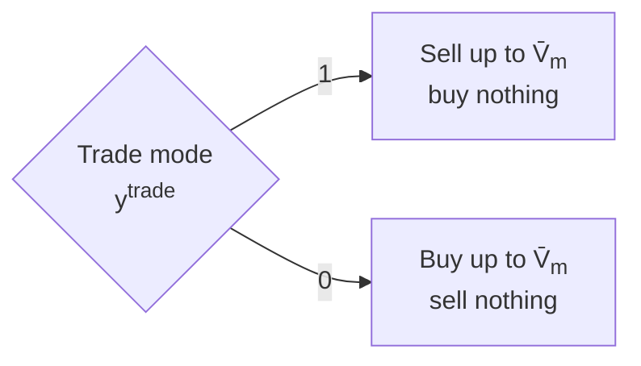

# Markets

How do I buy and sell? A market is your link to the outside world. When your own assets can't cover your demand, you buy the rest; when they make more than you need, or when prices are good, you sell. odys takes the market's price as given: your trades never move it.

This page covers every `EnergyMarket`. Each market adds the same few rules: a position limit you set on how much you trade per step, one direction per step, and, for some markets, only one direction at all.

## Sets and indices

Markets live in $\mathcal{M}$, with index $m$. Two subsets pick out the markets that only go one way, and a third the markets you commit to in advance:

| Set | What it holds | In odys |
| --- | ------------- | ------- |
| $\mathcal{M}^{buy} \subseteq \mathcal{M}$ | Markets you can only buy from | `allowed_trade_direction=AllowedTradeDirection.BUY_ONLY` |
| $\mathcal{M}^{sell} \subseteq \mathcal{M}$ | Markets you can only sell to | `allowed_trade_direction=AllowedTradeDirection.SELL_ONLY` |
| $\mathcal{M}^{fix} \subseteq \mathcal{M}$ | Stage-fixed markets | `stage_fixed=True` |

A market in neither $\mathcal{M}^{buy}$ nor $\mathcal{M}^{sell}$ can do both. That's the default, `AllowedTradeDirection.BUY_AND_SELL`.

## Variables

For each market, scenario and step, odys decides three things:

- $p^{buy}_{m,s,t} \ge 0$: how much you buy, in MW.
- $p^{sell}_{m,s,t} \ge 0$: how much you sell, in MW.
- $y^{trade}_{m,s,t} \in \{0, 1\}$: the trade mode, 1 when the market sells and 0 when it buys.

The trades are power, held for the whole step, so the energy you trade in step $t$ is $p^{buy}_{m,s,t}\,\Delta t$ or $p^{sell}_{m,s,t}\,\Delta t$.

You also give each market one number, its position limit, or cap, $\overline{V}_m$ (`max_trading_volume_per_step`, always above 0): the most you buy or sell on it at each step. It's your choice, not a property of the market. Today, the cap is in MW as well: the most energy you can trade in a step is $\overline{V}_m\,\Delta t$.

## Constraints

### M-1 · Trades stay within the position limit {#m-1}

In every step, you buy or sell at most your position limit on that market.

$$
p^{buy}_{m,s,t} \le \overline{V}_m, \qquad p^{sell}_{m,s,t} \le \overline{V}_m \qquad \forall m \in \mathcal{M},\ s \in \mathcal{S},\ t \in \mathcal{T}
$$

Read aloud: whatever you trade at a step, in either direction, stays below the limit you set for that market.

**Why it looks like this.** odys is a price-taker: whatever you trade, the price stays the same. Without a limit, that breaks down as soon as two markets have different prices at the same step. The optimizer would buy an endless amount on the cheaper market and sell it on the more expensive one, and the profit would have no upper bound. The cap is the largest position you'd take on the market, so the plan stays one you could carry out.

**Good to know.**

- [M-2](#m-2) already implies M-1: with $y^{trade}_{m,s,t} \in \{0, 1\}$, M-2 caps each direction at $\overline{V}_m$ or at 0. So M-1 never binds on its own ([#144](https://github.com/ramirocrc/odys/issues/144)).
- The cap bounds trading, but doesn't remove arbitrage. When two markets have different prices at a step, the optimizer still buys on one and sells on the other, up to the smaller of the two caps. If you don't want that, set the caps to the positions you'd really take, or make a market buy-only or sell-only ([M-3](#m-3)).
- Each cap limits one market, and nothing limits the site's total net purchase or sale across markets. With caps of 150 MW and 50 MW on two markets, the site can buy 200 MW at the same step ([#194](https://github.com/ramirocrc/odys/issues/194)).
- The cap is a power, in MW, although it's called a volume. Markets clear energy per delivery period, so a cap in MWh per step would be more natural ([#146](https://github.com/ramirocrc/odys/issues/146)).

`Added: always · Binds: never on its own (M-2 implies it) · Names: market_max_buy_volume_constraint, market_max_sell_volume_constraint`

### M-2 · A market buys or sells, not both {#m-2}

In each step, a market goes one way: you either buy from it or sell to it.

In words, the rule is:

$$
p^{buy}_{m,s,t} = 0 \ \text{ or } \ p^{sell}_{m,s,t} = 0 \qquad \forall m \in \mathcal{M},\ s \in \mathcal{S},\ t \in \mathcal{T}
$$

odys writes it with the trade mode $y^{trade}_{m,s,t}$, using the cap $\overline{V}_m$ as the big-M:

$$
p^{sell}_{m,s,t} \le y^{trade}_{m,s,t}\, \overline{V}_m, \qquad p^{buy}_{m,s,t} \le \left(1 - y^{trade}_{m,s,t}\right) \overline{V}_m \qquad \forall m \in \mathcal{M},\ s \in \mathcal{S},\ t \in \mathcal{T}
$$

Read aloud: pick a direction for this market at this step; trading the other way is closed until the next step.

**Why it looks like this.** In odys, a market has one price for both directions and no fees, so buying 50 MW and selling 30 MW at the same step is worth exactly as much as buying the net 20 MW. The binary makes the plan report that net position, one direction per step. The two inequalities switch the other direction off. The cap is a natural big-M: it's always finite, and it's the tightest value that doesn't cut off a real trade. The code writes the buy side as $p^{buy}_{m,s,t} + y^{trade}_{m,s,t}\,\overline{V}_m \le \overline{V}_m$, the same inequality rearranged.

**Good to know.**

- A market has one price for both directions, with no fees and no spread. Buying and selling the same amount cancels out in the [power balance](power_balance.md#pb-1) and in the profit, so a plan that does both is worth exactly as much as one that trades only the difference. The binary only removes those equivalent plans ([#140](https://github.com/ramirocrc/odys/issues/140)).
- It costs one binary per market, scenario and step: $|\mathcal{M}| \cdot |\mathcal{S}| \cdot |\mathcal{T}|$ in total.
- On a stage-fixed market, the trade mode is first-stage too: the direction is the same in every scenario ([NA-1](non_anticipativity.md#na-1)).

`Added: always · Binds: always (one direction per step is closed) · Names: market_mutual_exclusivity_buy_constraint, market_mutual_exclusivity_sell_constraint`

### M-3 · Some markets only go one way {#m-3}

On a buy-only market you never sell, and on a sell-only market you never buy.

$$
p^{sell}_{m,s,t} = 0 \quad \forall m \in \mathcal{M}^{buy}, \qquad p^{buy}_{m,s,t} = 0 \quad \forall m \in \mathcal{M}^{sell}, \qquad \forall s \in \mathcal{S},\ t \in \mathcal{T}
$$

Read aloud: if the market only sells to you, you can't sell back to it, and the other way round.

**Why it looks like this.** Not every outside connection works both ways. A supply contract may let you draw power but not feed it back, and an offtake agreement may buy your output but sell you nothing. Fixing the closed direction to zero says exactly that, without a new variable.

**Good to know.**

- The constraints are added in every model, but they only hold rows for the markets that restrict their direction. Without one, they're empty.
- M-2 still applies to these markets, so the trade mode simply ends up on the open side.
- The check odys runs before solving counts every market's cap as possible supply, a sell-only market included. That's one more reason the check is optimistic (see [PB-1](power_balance.md#pb-1) and [#149](https://github.com/ramirocrc/odys/issues/149)).

`Added: always (empty when no market restricts its direction) · Binds: on markets in ℳ^buy or ℳ^sell · Names: market_buy_only_constraint, market_sell_only_constraint`

### Stage-fixed markets

Some markets, like day-ahead, take your bids before you know which future happens. Mark them with `stage_fixed=True`, and odys gives their buy volume, sell volume and trade mode the same value in every scenario. That rule has its own page: see [NA-1](non_anticipativity.md#na-1).

## Power balance contribution

Buying brings power onto the bus and selling takes it away, so each market adds

$$
p^{buy}_{m,s,t} - p^{sell}_{m,s,t}
$$

to the [power balance](power_balance.md#pb-1) at every step, in MW.

## Objective contribution

Each market adds its trading revenue to the profit $\Pi_s$ of every scenario (see [Objective](objective.md#profit-per-scenario)):

$$
\sum_{m \in \mathcal{M}} \sum_{t \in \mathcal{T}} \left(p^{sell}_{m,s,t} - p^{buy}_{m,s,t}\right) \lambda_{m,s,t}\, \Delta t
$$

Read aloud: the energy you sell times its price, minus the energy you buy times its price.

- $\lambda_{m,s,t}$ comes from the market's `PriceProfile`, which every scenario has to provide. The price is the same for buying and selling, with no fees and no spread ([#169](https://github.com/ramirocrc/odys/issues/169)).
- Prices can be negative. Then selling costs money and buying earns it, and the optimizer may buy just to get paid, as long as something can absorb the power.

## Where to find each symbol in odys

| Symbol | Attribute | Type | Unit |
| ------ | --------- | ---- | ---- |
| $\mathcal{M}$ | `EnergyMarket` | Parameter | – |
| $\mathcal{M}^{buy}$, $\mathcal{M}^{sell}$ | `EnergyMarket.allowed_trade_direction` | Parameter | – |
| $\mathcal{M}^{fix}$ | `EnergyMarket.stage_fixed` | Parameter | – |
| $\overline{V}_m$ | `EnergyMarket.max_trading_volume_per_step` | Parameter | MW |
| $\lambda_{m,s,t}$ | `PriceProfile.values` | Parameter | currency per MWh |
| $p^{buy}_{m,s,t}$ | `market_buy_volume` · `results.markets.buy_volume` | Variable · Result | MW |
| $p^{sell}_{m,s,t}$ | `market_sell_volume` · `results.markets.sell_volume` | Variable · Result | MW |
| $p^{sell}_{m,s,t} - p^{buy}_{m,s,t}$ | `results.markets.net_volume` | Result | MW |
| $y^{trade}_{m,s,t}$ | `market_trade_mode` | Variable | – |

Buying isn't the only option: you can make your own power. See [Generators](generators.md).

---

Implemented in [`odys.optimization.formulations.energy_market`](../developer/api/optimization/formulations/energy_market.md).
