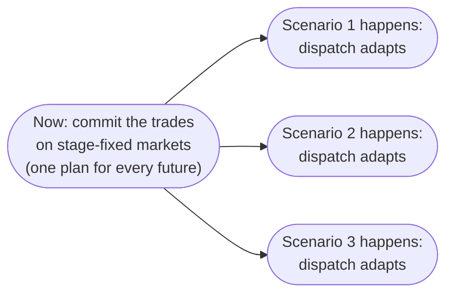

# Non-anticipativity

Some decisions can't wait. Take the day-ahead market: you send your bids today, and the market clears before you see tomorrow's prices. So how much should you bid, without knowing the price?

The simple answer is a **point forecast**: take the price you expect, and bid what would be best at that price. That works as long as the forecast is right, and the bid is only as good as that one guess.

You can do better with a **probabilistic forecast**. It gives you several possible price paths, each with a probability: the [scenarios](scenarios.md). Instead of betting on one of them, you look for the single bid that does best across all of them, weighed by how likely each one is.

This page shows how odys finds that bid.

## Decisions that can't wait

The [Scenarios](scenarios.md) page gave every decision one copy per scenario, and each copy knows its own future. That's fine for a battery reacting to prices as they come. It doesn't work for a bid: each copy would bid what is best for *its* prices, and you'd end up with a different bid per scenario. But you can only send one, and you have to send it before you know which prices will happen.

So a decision taken before the uncertainty resolves must take **the same value in every scenario**. That rule is called non-anticipativity: the decision doesn't anticipate the future. It's what turns "the best bid in each future" into one concrete bid you can actually send.

## Two stages

With non-anticipativity, the model becomes a **two-stage** problem. First, you commit to the decisions that can't wait. Then one of the futures happens, and everything else adapts to it:

| Stage | Decisions | Same in every scenario? |
| ----- | --------- | ----------------------- |
| First | Buy volume $p^{buy}_{m,s,t}$, sell volume $p^{sell}_{m,s,t}$ and trade mode $y^{trade}_{m,s,t}$ of every market with `stage_fixed=True` | Yes |
| Second | Everything else: other market trades, generator output and on/off status, battery charging, EV charging and charger assignment, flexible load adjustments | No, each scenario gets its own |

In odys, you choose the first stage per market, with `EnergyMarket(stage_fixed=True)`. Today, market trades are the only decisions that can be stage-fixed.

## NA-1 · Stage-fixed trades are the same in every scenario {#na-1}

Every trade on a stage-fixed market takes the same value in all scenarios.

$$
x_{m,s,t} = x_{m,s_0,t} \qquad \forall x \in \{p^{buy}, p^{sell}, y^{trade}\},\ m \in \mathcal{M}^{fix},\ s \in \mathcal{S},\ t \in \mathcal{T}
$$

Here $s_0$ is the first scenario, in the order you passed them to the `EnergySystem`.

Read aloud: on a stage-fixed market, whatever you buy or sell at a step in one future, you buy or sell in all of them.

**Why it looks like this.** Without it, the optimizer would place a different day-ahead bid in each future, as if it already knew tomorrow's prices when bidding. That is free clairvoyance, and the plan would look far better than anything you could actually do. Tying every scenario to the first one rules it out.

You could write the same thing with a single variable shared by all scenarios. odys keeps one copy per scenario and ties the copies together instead. That way every market variable has the same shape (asset, scenario, time) as every other variable in the model, and the rest of the formulation never has to treat stage-fixed markets differently.

**Good to know.**

- odys also writes the row for $s_0$ itself, where it simply reads $x = x$.
- The trade mode $y^{trade}$ is tied too, so a stage-fixed market also picks "buy" or "sell" once for all futures. The trade mode only removes plans that are worth the same profit; see [#140](https://github.com/ramirocrc/odys/issues/140).
- Generator commitment is second-stage: a unit can be on in one scenario and off in another at the same step. If a unit has to be scheduled in advance, model that commitment through a stage-fixed market position.

`Added: always (empty without a stage-fixed market) · Binds: on markets with stage_fixed=True · Names: non_anticipativity_market_buy_volume_constraint, non_anticipativity_market_sell_volume_constraint, non_anticipativity_market_trade_mode_constraint`

## What it changes in the plan

Without non-anticipativity, each scenario would get its own ideal bid. With it, there is one bid, and it has to work in every future. If prices come in high, you may wish you had sold more, and a battery or a generator makes up some of it; if they come in low, you may be left with energy to store or sell back on another market. The second-stage decisions make up the difference in each future, and the bid lands where the probability-weighted outcome is best.

That's also what makes the scenarios interact: the first-stage trades are shared, so a choice that helps one future affects all the others. The risk term [CV-1](objective.md#cv-1) is the only other link between them.

## Where to find each symbol in odys

| Symbol | Attribute | Type | Unit |
| ------ | --------- | ---- | ---- |
| $\mathcal{M}^{fix}$ | `EnergyMarket.stage_fixed` | Parameter | – |
| $s_0$ | the first `Scenario` passed to `EnergySystem` | Parameter | – |
| $p^{buy}_{m,s,t}$ | `market_buy_volume` · `results.markets.buy_volume` | Variable · Result | MW |
| $p^{sell}_{m,s,t}$ | `market_sell_volume` · `results.markets.sell_volume` | Variable · Result | MW |
| $y^{trade}_{m,s,t}$ | `market_trade_mode` | Variable | – |

Decisions are made *for* something. What is odys chasing? See the [Objective](objective.md).

---

Implemented in [`odys.optimization.formulations.energy_market`](../developer/api/optimization/formulations/energy_market.md).
