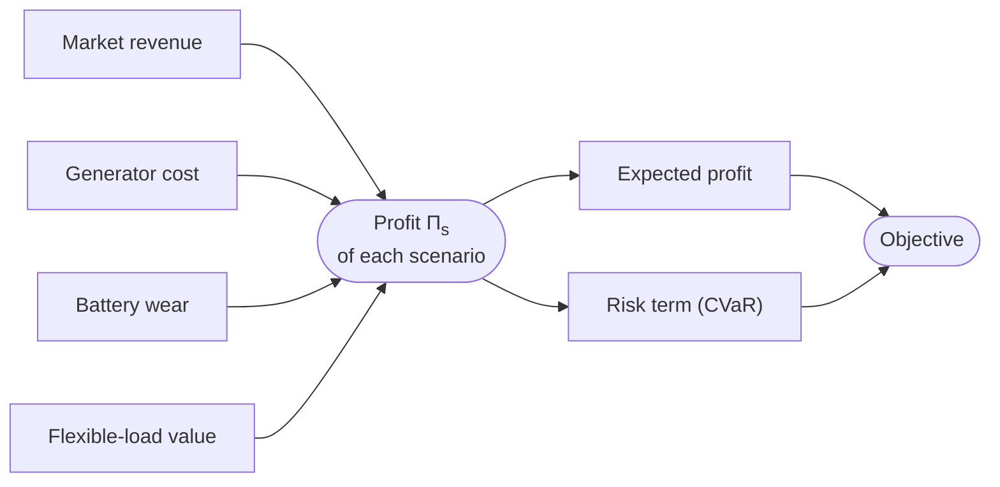

# Objective

What counts as a good plan? For odys, it's simple: the one that makes the most money. Money comes in when you sell energy or use it well, and goes out when you buy it, burn fuel or wear a battery down. odys adds that up for each scenario, then weighs the scenarios against each other.

This page defines that sum once. Every asset page has an "Objective contribution" section that points back here, to its own part of it.

## Profit per scenario

The profit $\Pi_s$ of scenario $s$ is everything earned minus everything spent, over the whole horizon, if that future happens:

$$
\begin{aligned}
\Pi_s ={} & \sum_{m \in \mathcal{M}} \sum_{t \in \mathcal{T}} \left(p^{sell}_{m,s,t} - p^{buy}_{m,s,t}\right) \lambda_{m,s,t}\, \Delta t
&& \text{market revenue} \\
& - \sum_{g \in \mathcal{G}} \sum_{t \in \mathcal{T}} \left(c^{var}_g\, p_{g,s,t}\, \Delta t + c^{start}_g\, y^{start}_{g,s,t} + c^{stop}_g\, y^{stop}_{g,s,t}\right)
&& \text{generator cost} \\
& - \sum_{k \in \mathcal{K}} \sum_{t \in \mathcal{T}} c^{deg}_k \left(p^{ch}_{k,s,t} + p^{dis}_{k,s,t}\right) \Delta t
&& \text{battery wear} \\
& + \sum_{l \in \mathcal{L}} \sum_{t \in \mathcal{T}} c^{val}_l\, d_{l,s,t}\, \Delta t
&& \text{flexible-load value}
\end{aligned}
$$

Read aloud: what you sell minus what you buy, at that scenario's prices; minus what your generators cost to run, start and stop; minus what your batteries lose in wear; plus what your flexible loads' consumption is worth.

Each line belongs to one page:

- **Market revenue**, on [Markets](markets.md#objective-contribution). Selling earns the price, buying pays it. With a negative price, it's the other way round.
- **Generator cost**, on [Generators](generators.md#objective-contribution). Fuel is paid per MWh, start-ups and shut-downs per event.
- **Battery wear**, on [Batteries](batteries.md#objective-contribution) and [Electric vehicles](electric_vehicles.md#objective-contribution). Every MWh in or out counts, so a full cycle pays twice.
- **Flexible-load value**, on [Flexible loads](flexible_loads.md#objective-contribution). Every MWh they use is worth $c^{val}_l$.

Fixed loads and chargers add nothing of their own. Serving a fixed demand still costs money, but that cost already shows up in the lines above: the energy you buy for it, or the fuel your generators burn.

**Good to know.**

- All of a flexible load's consumption is valued, including the part its lower bound forces. A fixed load's consumption is not valued at all. So $\Pi_s$ is a profit for decision-making, not the total welfare or the total cost of your site.
- A trip's energy has no price of its own. It costs whatever it takes to charge the vehicle back up.

## Expected profit

The scenarios meet here. Each scenario's profit counts in proportion to how likely that future is:

$$
\mathbb{E}[\Pi] = \sum_{s \in \mathcal{S}} \pi_s\, \Pi_s
$$

Read aloud: the profit you'd make on average, if you could replay tomorrow many times.

This is the term odys always has: an `Objective` must include a `ProfitTerm`, and the default objective is just this one, with weight 1.

**Why it looks like this.** The average is the natural target when you make the same kind of decision day after day: good and bad days even out, and what's left is the average. Its blind spot is that it doesn't care how bad the bad days are. A plan that wins a lot in most futures and loses heavily in one can beat a steadier plan. If that one loss would hurt, you need the next term.

## Conditional value at risk

The conditional value at risk (CVaR) looks only at the bad days. At confidence level $\alpha$, it's the average profit over the worst $1 - \alpha$ share of futures. With $\alpha = 0.9$, take the futures that together make up the worst 10 % of probability, and average their profit. A higher CVaR means the bad days are less bad.

That average is hard to write directly, because which futures are "the worst" depends on the plan. odys uses the formulation of Rockafellar and Uryasev, which turns it into a linear one with two helper variables:

$$
\mathrm{CVaR}_\alpha(\Pi) = \zeta - \frac{1}{1 - \alpha} \sum_{s \in \mathcal{S}} \pi_s\, \xi_s
$$

- $\zeta$ is a profit threshold, one number for all scenarios.
- $\xi_s \ge 0$ is how far scenario $s$ falls short of it ([CV-1](#cv-1)).

Read aloud: pick a threshold, then subtract the expected shortfall below it, scaled up to the size of the tail.

At the optimum, $\zeta$ lands on the **value at risk**: the profit level that the worst $1 - \alpha$ of futures fall at or below. The futures above it have no shortfall, and the ones below pull the CVaR down. With a finite set of scenarios, a whole range of thresholds can be equally good, and the solver returns one of them.

### CV-1 · Each scenario's shortfall below the threshold {#cv-1}

The shortfall of a scenario is at least how far its profit falls below the threshold.

$$
\xi_s \ge \zeta - \Pi_s, \qquad \xi_s \ge 0 \qquad \forall s \in \mathcal{S}, \qquad \zeta \in \mathbb{R}
$$

Read aloud: if a future earns less than the threshold, its shortfall is at least the gap; if it earns more, the shortfall is zero.

**Why it looks like this.** Without it, nothing would tie the threshold to the profits. The optimizer would keep every shortfall at zero, raise $\zeta$ as high as it likes, and report a plan without risk, however bad its worst futures are. CV-1 makes every unit of $\zeta$ above a scenario's profit cost a unit of shortfall in that scenario. Since the objective wants shortfalls small, each $\xi_s$ ends up exactly at $\max(0, \zeta - \Pi_s)$.

**Good to know.**

- CV-1 links the scenarios: they all share one $\zeta$, so they no longer solve on their own (see [Scenarios](scenarios.md#when-scenarios-are-solved-on-their-own)).
- It adds only continuous variables: one $\zeta$ and one $\xi_s$ per scenario. The problem gets no new binaries.

`Added: only with a CVaRTerm · Binds: in the scenarios whose profit is below ζ · Name: cvar_shortfall_constraint`

## Combined objective

odys maximizes the weighted sum of the two terms:

$$
\max\ w^P\, \mathbb{E}[\Pi] + w^C\, \mathrm{CVaR}_\alpha(\Pi)
$$

subject to every constraint in this section. The weights $w^P$ (`ProfitTerm.weight`) and $w^C$ (`CVaRTerm.weight`) are how much you care about the average day against the bad days.

Read aloud: make the most money on average, but also keep the bad days from getting too bad, in the proportion you chose.

**Good to know.**

- The weights are two independent numbers, both at least 0. They don't have to add up to 1, and odys doesn't normalize them. Only their ratio changes the plan: doubling both doubles the objective value and leaves the plan as it was.
- The objective value that odys reports (`results.objective_value`) is this weighted sum, not the expected profit. The parts (each scenario's profit, the expected profit, the CVaR and $\zeta$) aren't reported yet ([#152](https://github.com/ramirocrc/odys/issues/152)).
- A weight of 0 keeps a term in the configuration but removes it from the objective.
- odys accepts every weight at 0 today. The objective is then always 0, and any feasible plan counts as optimal ([#151](https://github.com/ramirocrc/odys/issues/151)).
- With $w^P = 0$, only the worst futures count. The other scenarios get *some* feasible plan, not necessarily a good one.

## Where to find each symbol in odys

| Symbol | Attribute | Type | Unit |
| ------ | --------- | ---- | ---- |
| $\Pi_s$ | the profit of scenario $s$ | Expression | currency |
| $w^P$ | `ProfitTerm.weight` | Parameter | – |
| $w^C$ | `CVaRTerm.weight` | Parameter | – |
| $\alpha$ | `CVaRTerm.confidence_level` | Parameter | – |
| $\zeta$ | `cvar_value_at_risk` | Variable | currency |
| $\xi_s$ | `cvar_shortfall` | Variable | currency |
| $c^{var}_g$ | `Generator.variable_cost` | Parameter | currency per MWh |
| $c^{start}_g$ | `Generator.commitment.startup_cost` | Parameter | currency per start-up |
| $c^{stop}_g$ | `Generator.commitment.shutdown_cost` | Parameter | currency per shut-down |
| $c^{deg}_k$ | `Battery.degradation_cost` | Parameter | currency per MWh |
| $c^{val}_l$ | `FlexibleLoad.value_of_consumption` | Parameter | currency per MWh |
| $\lambda_{m,s,t}$ | `PriceProfile.values` | Parameter | currency per MWh |
| – | `results.objective_value` | Result | currency |

Profit is earned on energy, and energy has to add up at every step. See [Power balance](power_balance.md).

---

Implemented in [`odys.optimization.objective_terms`](../developer/api/optimization/objective_terms/index.md) ([`profit`](../developer/api/optimization/objective_terms/profit.md), [`cvar`](../developer/api/optimization/objective_terms/cvar.md)).
