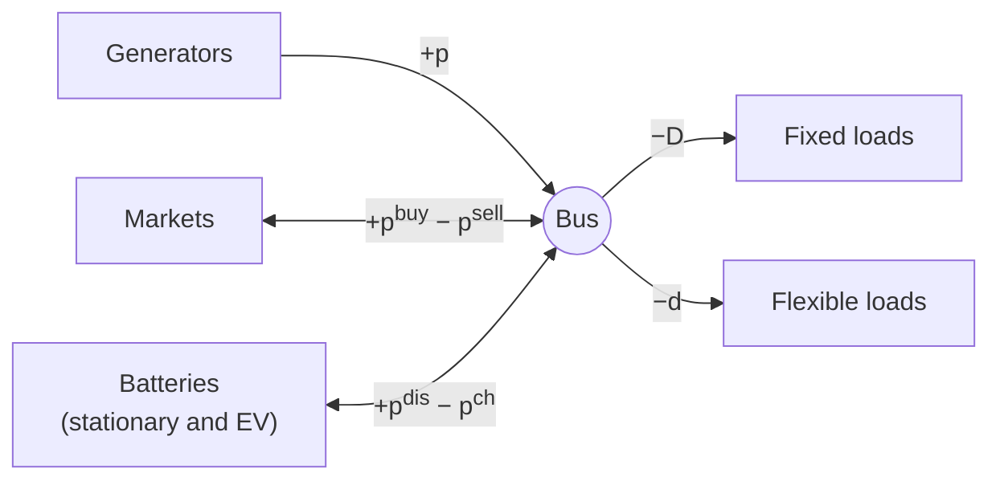

# Power balance

What ties every asset together? One rule: at every step, the power that goes in has to match the power that goes out. Generators, batteries and markets can each make their own plans, but this rule makes them work as one system. It's the only constraint in odys that sees every asset at once.

This page also introduces the fixed loads, because the balance is the only place they appear.

## One bus

odys connects every asset and every market to a single point, the **bus**. There are no lines, no network and no losses between assets: power fed in anywhere can serve demand anywhere. This is often called a "copper plate".

Each arrow is one term of the balance, with the sign from the [sign convention](notation.md#sign-convention): power into the bus is positive.

## Fixed loads

A fixed load is demand you have to serve exactly as given: a building, a process that can't move, a site's base consumption. Its demand $D_{l,s,t}$ for $l \in \mathcal{L}^{fix}$ comes from its `LoadProfile`, one per scenario. odys doesn't check its sign today, so a negative value would quietly act as supply ([#148](https://github.com/ramirocrc/odys/issues/148)).

That's all there is to it. A fixed load has no decision variables, no constraints of its own and no term in the [Objective](objective.md). Serving it costs money, but that cost shows up elsewhere: in the energy you buy for it, or the fuel your generators burn.

## PB-1 · Supply meets demand at every step {#pb-1}

In every scenario and at every step, the power fed into the bus equals the power taken from it.

$$
\sum_{g \in \mathcal{G}} p_{g,s,t}
+ \sum_{m \in \mathcal{M}} \left(p^{buy}_{m,s,t} - p^{sell}_{m,s,t}\right)
+ \sum_{k \in \mathcal{K}} \left(p^{dis}_{k,s,t} - p^{ch}_{k,s,t}\right)
- \sum_{l \in \mathcal{L}^{fix}} D_{l,s,t}
- \sum_{l \in \mathcal{L}} d_{l,s,t}
= 0
\qquad \forall s \in \mathcal{S},\ t \in \mathcal{T}
$$

Read aloud: what your generators make, plus what you buy, plus what your batteries give back, equals what you sell, plus what your batteries take in, plus what your loads use.

**Why it looks like this.** Without it, every asset would do what pays best on its own: generators would sit idle, batteries would never charge, and demand would simply go unserved. The balance is what forces the plan to keep the lights on. Writing it as one equation with every injection summed makes adding an asset type easy: it brings its own term, and nothing else changes.

**Good to know.**

- It's a **hard equality**, with no slack and no "unserved energy" variable. If some future can't be balanced, the whole problem is infeasible, not just that scenario (see [Scenarios](scenarios.md#when-scenarios-are-solved-on-their-own)). The solver doesn't say which scenario or step is to blame; an optional slack that would show it is proposed in [#150](https://github.com/ramirocrc/odys/issues/150).
- There's no curtailment variable either. Surplus power has to go somewhere: sold, stored, or absorbed by a flexible load.
- Batteries count once, whether they sit at a site or on wheels: $\mathcal{K} = \mathcal{B} \cup \mathcal{E}$. An EV charges from the bus and, with V2G, feeds back into it. Chargers add no term of their own: they only cap and assign the power the vehicles draw (see [Electric vehicles and chargers](electric_vehicles.md)).
- Energy a vehicle uses while driving doesn't pass through the bus. It leaves the battery directly.
- Before solving, odys checks each scenario for an obvious mismatch: at every step, the most power you could possibly supply must cover the least you must serve, and the same over the whole horizon in energy. These checks are optimistic, so a model that passes them can still be infeasible, but one that fails them certainly is. They even count a sell-only market as possible supply ([#149](https://github.com/ramirocrc/odys/issues/149)).

`Added: always · Binds: always · Name: power_balance_constraint`

## Where to find each symbol in odys

| Symbol | Attribute | Type | Unit |
| ------ | --------- | ---- | ---- |
| $\mathcal{L}^{fix}$ | `FixedLoad` | Parameter | – |
| $D_{l,s,t}$ | `LoadProfile.values` | Parameter | MW |
| $p_{g,s,t}$ | `generator_power` · `results.generators.power` | Variable · Result | MW |
| $p^{buy}_{m,s,t}$ | `market_buy_volume` · `results.markets.buy_volume` | Variable · Result | MW |
| $p^{sell}_{m,s,t}$ | `market_sell_volume` · `results.markets.sell_volume` | Variable · Result | MW |
| $p^{ch}_{k,s,t}$ | `battery_storage_power_in`, `ev_power_in` | Variable | MW |
| $p^{dis}_{k,s,t}$ | `battery_storage_power_out`, `ev_power_out` | Variable | MW |
| $d_{l,s,t}$ | `flexible_load_consumption` · `results.flexible_loads.consumption` | Variable · Result | MW |

Who fills the gap? First, the outside world. See [Markets](markets.md).

---

Implemented in [`odys.optimization.power_balance`](../developer/api/optimization/power_balance.md) and [`odys.optimization.formulations.fixed_load`](../developer/api/optimization/formulations/fixed_load.md).
