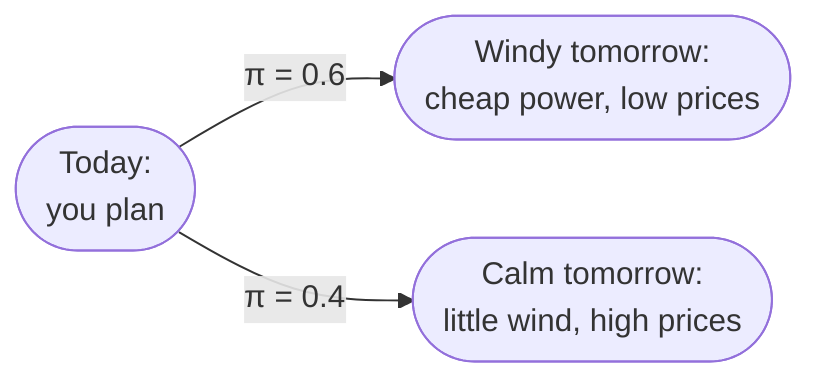

# Scenarios

Energy systems live with uncertainty. Tomorrow could be windy or calm, sunny or grey. Prices could spike or fall, and demand could come in higher than forecast. A plan built for one assumed future can look great on paper and go wrong as soon as the real day turns out differently. This page shows how odys plans against several possible futures at once.

The User Guide's [Stochastic optimization](../user_guide/optimization/stochastic.md) page shows how to set scenarios up in code. Here we look at what they do to the model.

## One future, or several

A **deterministic** optimization takes one forecast and treats it as certain. It finds the best plan for that single future, and has nothing to say about any other.

A **stochastic** optimization takes a set of possible futures, each with a probability, and finds the plan that does best across all of them. Say tomorrow is windy with probability 0.6 and calm with probability 0.4. Rather than betting everything on the wind, odys plans for both, and weighs each outcome by how likely it is.

Each of these possible futures is a **scenario**.

## What a scenario is

A scenario $s \in \mathcal{S}$ is one complete version of the uncertain inputs. It carries its own profiles:

- market prices $\lambda_{m,s,t}$ (`PriceProfile`),
- demand $D_{l,s,t}$ (`LoadProfile`),
- available capacity $A_{g,s,t}$ (`AvailableCapacityProfile`).

Scenario $s$ happens with probability $\pi_s$:

$$
\pi_s \in [0, 1] \quad \forall s \in \mathcal{S}, \qquad \sum_{s \in \mathcal{S}} \pi_s = 1
$$

odys checks that the probabilities add up to 1 before solving. Everything that isn't uncertain is shared by all scenarios: the assets you own, the horizon, and the initial and final conditions.

## How scenarios enter the model

Every decision gets one copy per scenario. That's what the index $s$ in $p_{g,s,t}$ means: the output of generator $g$ at step $t$ *if scenario $s$ happens*. In each scenario, the optimizer sees that future's whole horizon at once, so each copy is the best plan for its own future, with perfect foresight.

The scenarios then meet in the objective, which weighs each scenario's profit by its probability $\pi_s$ (see [Objective](objective.md)). A likely future counts more than an unlikely one.

A single `Scenario` is the case $|\mathcal{S}| = 1$ with $\pi_s = 1$. Every equation in this section then reads as the plain deterministic model, so there is no separate deterministic version to learn.

## When scenarios are solved on their own

Nothing so far ties one scenario's plan to another's. Each copy only has to be feasible in its own future, and the objective simply adds up the weighted profits. So unless something links them, the best plan for the whole set is just the best plan for each scenario on its own: solving them together gives the same answer as solving them one by one.

Two things link scenarios: [non-anticipativity](non_anticipativity.md), for decisions that must be the same in every future, and the risk term [CV-1](objective.md#cv-1), when the objective has one.

**Good to know.**

- A scenario with $\pi_s = 0$ is allowed. It doesn't count in the objective, so its plan is just *some* feasible plan, not necessarily a good one.
- Every scenario must be feasible. If one future can't be served, the whole problem is infeasible, even if that future is very unlikely.
- The solver's optimality gap applies to the whole problem, not to each scenario: a scenario with a small probability can be further from its own best plan than the gap suggests.

## Where to find each symbol in odys

| Symbol | Attribute | Type | Unit |
| ------ | --------- | ---- | ---- |
| $\mathcal{S}$ | `EnergySystem(scenarios=...)` | Parameter | – |
| $\pi_s$ | `Scenario.probability` | Parameter | – |
| $\lambda_{m,s,t}$ | `PriceProfile.values` | Parameter | currency per MWh |
| $D_{l,s,t}$ | `LoadProfile.values` | Parameter | MW |
| $A_{g,s,t}$ | `AvailableCapacityProfile.values` | Parameter | MW |

Each scenario now has its own plan, but you can only send one day-ahead bid. Which decisions must be the same in every future? See [Non-anticipativity](non_anticipativity.md).

---

Implemented in [`odys.domain.scenario`](../developer/api/domain/scenario.md) and [`odys.parameters.context`](../developer/api/parameters/context.md).
