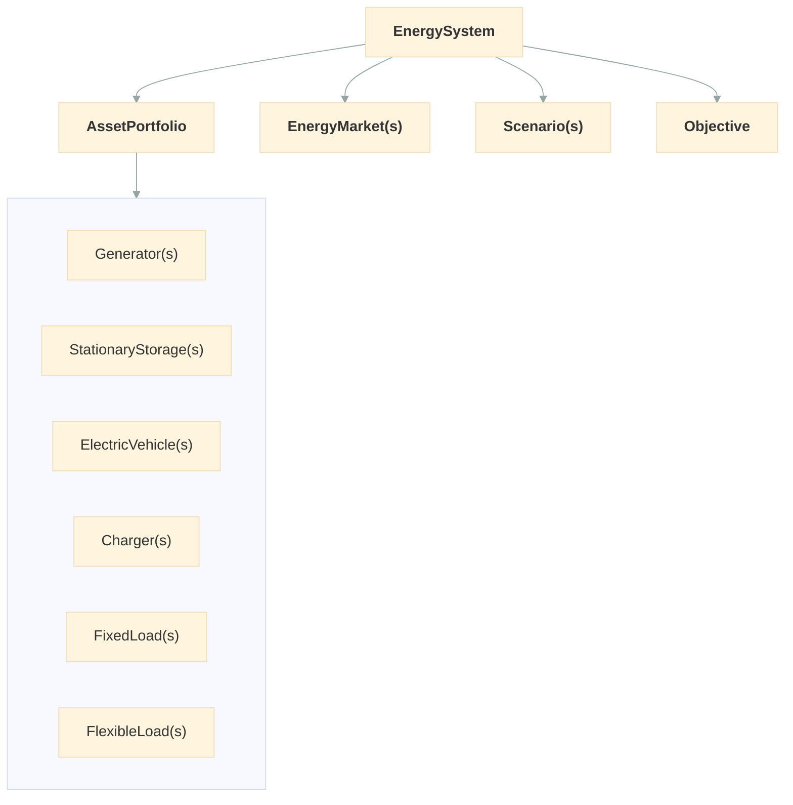

# User Guide

odys plans how a portfolio of energy assets is operated and traded over a horizon: when each generator runs, when each battery charges, how far flexible demand moves, and what is bought and sold on each market. It plans against one future or several, each with its own probability, and solves the plan as a mixed-integer linear program.

You describe what you own, the markets you trade on and the futures you plan for. odys returns the dispatch that maximizes your expected profit, optionally weighed against risk.

## How the pieces fit together

- The [EnergySystem](model/first_model.md) holds everything, with the horizon and each asset's starting state, and runs `.optimize()`.
- The [AssetPortfolio](model/first_model.md#the-portfolio) holds the assets you own and operate: [generators](assets/generator.md), [fixed](assets/fixed_load.md) and [flexible](assets/flexible_load.md) loads, [stationary storage](assets/stationary_storage.md), [electric vehicles](assets/electric_vehicle.md) and [chargers](assets/charger.md). Stationary storage and electric vehicles each have a [Battery](assets/battery.md).
- [EnergyMarkets](markets/energy_market.md) are where the portfolio buys and sells.
- A [Scenario](model/profiles.md) holds the time series of one possible future, its profiles: demand, available capacity and prices.
- The [Objective](optimization/objective.md) says what to maximize: expected profit, optionally balanced against risk.

## One bus

odys connects every asset and every market to a single bus. At every step and in every scenario, the power fed in equals the power taken out:

| Feeds the bus | Draws from the bus |
| ------------- | ------------------ |
| [Generator](assets/generator.md) output | [FixedLoad](assets/fixed_load.md) demand |
| [Battery](assets/battery.md) discharge, from stationary storage and vehicles with V2G | [FlexibleLoad](assets/flexible_load.md) demand, after its adjustment |
| [EnergyMarket](markets/energy_market.md) purchases | Battery charging |
| | EnergyMarket sales |

There's no network: no lines, no congestion and no losses between assets, so power fed in anywhere serves demand anywhere. [Chargers](assets/charger.md) aren't on the bus themselves: the vehicles plugged into them are.

There's no unserved energy either. All demand has to be met, so a system whose supply can't cover it has no solution. odys catches the obvious cases when you create the `EnergySystem` (see [Validation and errors](solving/validation.md)). See [PB-1](../formulation/power_balance.md#pb-1).

## The running example

Most pages build on one small industrial site, so you can watch a single system grow as you read. The horizon is four hourly steps:

| Name        | Object              | What it is                                                    | Introduced on                                     |
| ----------- | ------------------- | ------------------------------------------------------------- | ------------------------------------------------- |
| `ccgt`      | `Generator`         | Gas plant, 100 MW at 50 $/MWh                                 | [Your first model](model/first_model.md)          |
| `factory`   | `FixedLoad`         | Demand of 60, 90, 40 and 70 MW                                | [Your first model](model/first_model.md)          |
| `wind`      | `Generator`         | Wind farm, 80 MW, free, with 40, 10, 60 and 30 MW available    | [Profiles](model/profiles.md)                     |
| `process`   | `FlexibleLoad`      | Process drawing 30 MW, can go +20 or −10 MW, worth 60 $/MWh   | [FlexibleLoad](assets/flexible_load.md)           |
| `bess`      | `StationaryStorage` | Battery, 50 MWh at 25 MW, starting half full                  | [Battery](assets/battery.md)                      |
| `day_ahead` | `EnergyMarket`      | Day-ahead market, 150 MW, at 40, 75, 30 and 65 $/MWh          | [EnergyMarket](markets/energy_market.md)          |

[Your first model](model/first_model.md) starts with just the CCGT and the factory, and each later page adds one piece. Every code block on a page runs in order, from the first block of that page.

Electric vehicles and chargers are a different scale of problem, a depot rather than a site, so their pages use a small van fleet instead.

## Reading order

The guide starts with a stretch to read in order, then turns into pages to look up:

1. **Building a model**: [Your first model](model/first_model.md) sets up and solves a first system, [Time and units](model/time_and_units.md) say how odys reads every value, and [Profiles](model/profiles.md) add its time series. Read these in order.
2. **Assets** and **Markets**: one page per type, all with the same structure. They also build the running example step by step, from the [Generator](assets/generator.md) to the [EnergyMarket](markets/energy_market.md), but each one stands on its own.
3. **Solving and results**: how to read the [Results](solving/results.md), choose a [solver](optimization/solvers.md), and what odys checks before solving, in [Validation and errors](solving/validation.md).
4. **Uncertainty and risk**: planning against several futures with [Stochastic optimization](optimization/stochastic.md), and weighing bad outcomes in the [Objective](optimization/objective.md).

The exact model odys builds is written out in the [Mathematical Formulation](../formulation/index.md) section.

## Next steps

Start with [Your first model](model/first_model.md) to set up and solve a first system.
