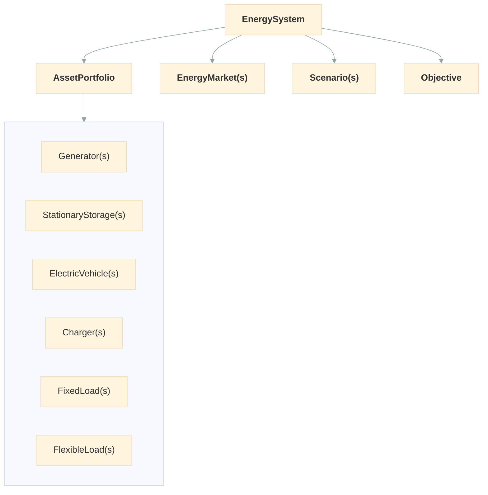

# User Guide

Odys optimizes how a portfolio of energy assets is operated. You describe what you own, the conditions it runs under, and the markets it can trade in, then let the optimizer decide the dispatch.

## How the pieces fit together

- The [EnergySystem](concepts/energy_system.md) is the entry point: it holds everything and runs `.optimize()`.
- The [AssetPortfolio](concepts/asset_portfolio.md) holds the assets you own and operate: [generators](assets/generator.md), [fixed](assets/fixed_load.md) and [flexible](assets/flexible_load.md) loads, [storage](assets/stationary_storage.md), [electric vehicles](assets/electric_vehicle.md) and [chargers](assets/charger.md). Storage and electric vehicles each have a [Battery](assets/battery.md).
- [EnergyMarkets](markets/energy_market.md) are where the portfolio buys and sells energy.
- [Scenarios](concepts/scenario.md) hold the time series: demand, available capacity, and prices.
- [Initial and final conditions](concepts/initial_and_final_conditions.md) set where each asset starts and, optionally, ends the run.
- The [Objective](optimization/objective.md) says what to maximize: expected profit, optionally balanced against risk.

## The running example

Most pages build on one small industrial site, so you can watch a single system grow as you read. The horizon is four hourly steps:

| Name        | Object              | What it is                                                    | Introduced on                                     |
| ----------- | ------------------- | ------------------------------------------------------------- | ------------------------------------------------- |
| `ccgt`      | `Generator`         | Gas plant, 100 MW at 50 $/MWh                                 | [EnergySystem](concepts/energy_system.md)         |
| `factory`   | `FixedLoad`         | Demand of 60, 90, 40 and 70 MW                                | [EnergySystem](concepts/energy_system.md)         |
| `wind`      | `Generator`         | Wind farm, 80 MW, free, with 40, 10, 60 and 30 MW available    | [Scenarios & Profiles](concepts/scenario.md)      |
| `process`   | `FlexibleLoad`      | Process drawing 30 MW, can go +20 or −10 MW, worth 60 $/MWh   | [FlexibleLoad](assets/flexible_load.md)           |
| `bess`      | `StationaryStorage` | Battery, 50 MWh at 25 MW, starting half full                  | [StationaryStorage](assets/stationary_storage.md) |
| `day_ahead` | `EnergyMarket`      | Day-ahead market, 150 MW, at 40, 75, 30 and 65 $/MWh          | [EnergyMarket](markets/energy_market.md)          |

The [EnergySystem](concepts/energy_system.md) page starts with just the CCGT and the factory, and each later page adds one piece. Every code block on a page runs in order, from the first block of that page.

Electric vehicles and chargers are a different scale of problem, a depot rather than a site, so their pages use a small van fleet instead.

## Units and time

Odys does not convert units. Use these throughout:

| Quantity                  | Unit           | Examples                                                                 |
| ------------------------- | -------------- | ------------------------------------------------------------------------ |
| Power                     | MW             | `nominal_power`, `max_charge_power`, load and capacity profiles          |
| Energy                    | MWh            | `capacity`, `energy_consumption`                                         |
| Prices and variable costs | currency / MWh | `variable_cost`, `value_of_consumption`, `PriceProfile`                  |
| Per-event costs           | currency       | `startup_cost`, `shutdown_cost`                                          |
| State of charge           | fraction (0-1) | `soc`, `soc_min`, `soc_max`                                              |

Profit terms multiply power by the timestep length in hours, so MW and currency/MWh are what make the numbers come out right. For a small asset such as an EV, write 22 kW as `0.022`.

Time is always a `timedelta`: the `timestep`, a generator's `min_up_time`, `min_down_time` and `time_in_state`, and a `Trip`'s `start_time` and `end_time`, which are measured from the start of the horizon. Each must be a whole number of timesteps.

Ramp limits (`ramp_up`, `ramp_down`) are **per timestep**, not per hour: a 40 MW ramp limit means 40 MW per 15 minutes with 15-minute steps. A battery's `self_discharge_rate`, on the other hand, is a fraction per hour.

## Reading order

1. **Core concepts**: [EnergySystem](concepts/energy_system.md), [AssetPortfolio](concepts/asset_portfolio.md), [Scenarios & Profiles](concepts/scenario.md), [Initial and final conditions](concepts/initial_and_final_conditions.md), and the [Power balance](concepts/power_balance.md) that ties everything together.
2. **Assets**: one page per asset type, each with the same structure. Start from [Generator](assets/generator.md).
3. **Markets**: [EnergyMarket](markets/energy_market.md).
4. **Optimization**: the [Objective](optimization/objective.md), how to read [Results](optimization/results.md), [Stochastic optimization](optimization/stochastic.md) for decisions under uncertainty, and how to configure [Solvers](optimization/solvers.md).

The exact model odys builds is written out in the [Mathematical Formulation](../formulation/index.md) section.

## Next steps

Start with [EnergySystem](concepts/energy_system.md) to set up and solve your first system.
