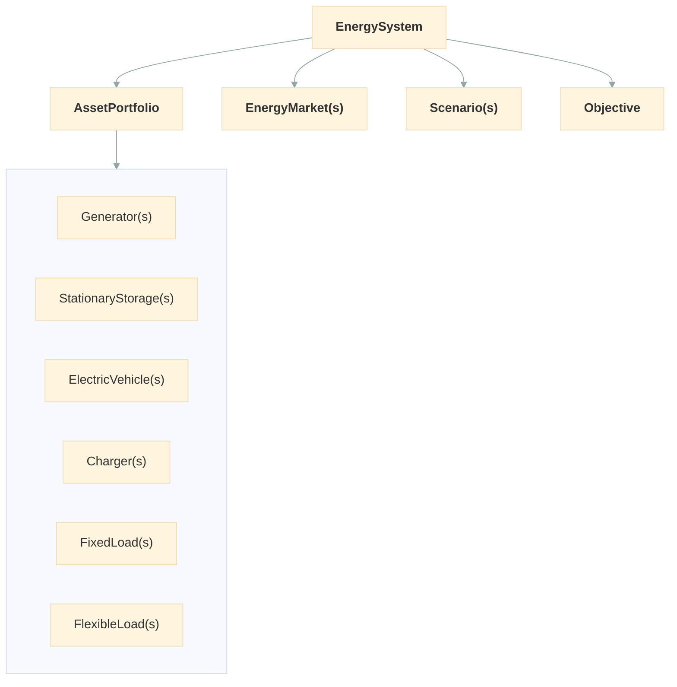

# User Guide

Odys optimizes how a portfolio of energy assets is operated. You describe what you own, the conditions it runs under, and the markets it can trade in, then let the optimizer decide the dispatch.

## How the pieces fit together

- The [EnergySystem](concepts/energy_system.md) is the entry point: it holds everything and runs `.optimize()`.
- The [AssetPortfolio](concepts/asset_portfolio.md) holds the [assets](assets/index.md) you own and operate.
- [EnergyMarkets](markets/energy_market.md) are where the portfolio buys and sells energy.
- [Scenarios](concepts/scenario.md) hold the time series: demand, available capacity, and prices.
- [Initial and final conditions](concepts/initial_and_final_conditions.md) set where each asset starts and, optionally, ends the run.
- The [Objective](optimization/objective.md) says what to maximize: expected profit, optionally balanced against risk.

## Reading order

1. **Core concepts**: [EnergySystem](concepts/energy_system.md), [AssetPortfolio](concepts/asset_portfolio.md), [Scenarios & Profiles](concepts/scenario.md), [Initial and final conditions](concepts/initial_and_final_conditions.md), and the [Power balance](concepts/power_balance.md) that ties everything together.
2. **Assets**: one page per asset type, each with the same structure. Start from the [Assets overview](assets/index.md).
3. **Markets**: [EnergyMarket](markets/energy_market.md).
4. **Optimization**: the [Objective](optimization/objective.md), [Stochastic optimization](optimization/stochastic.md) for decisions under uncertainty, how to read [Results](optimization/results.md), and how to configure [Solvers](optimization/solvers.md).

Every symbol used in the formulations is listed in [Mathematical notation](mathematical_notation.md).

## Next steps

Start with [EnergySystem](concepts/energy_system.md) to set up your first optimization.
